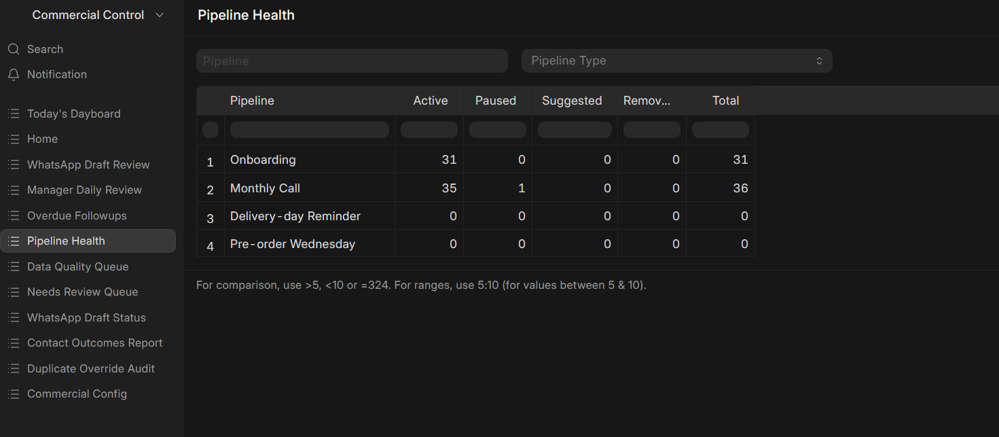
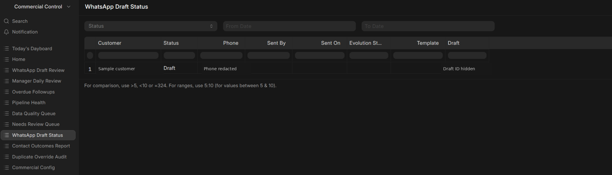
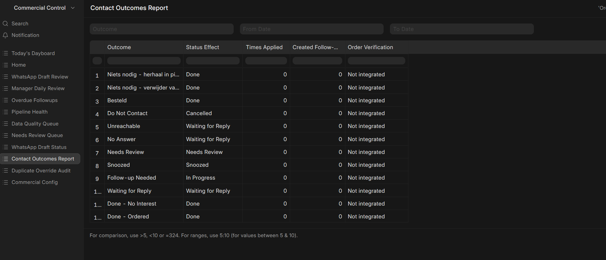

# CRM Dayboard: Reports and Monitoring

**Audience:** Sales, Commercial Managers and Commercial Admins, according to role and report permissions.  
**Source:** The Commercial Control Tower `report/` modules, Manager Daily Review page and the submitted screenshots.

The sidebar provides specialized reports. They complement the Dayboard: reports help managers investigate trends and exceptions; the Dayboard is where sales staff perform the daily work.

## On this page

- [Pipeline Health](#pipeline-health)
- [WhatsApp Draft Status](#whatsapp-draft-status)
- [Contact Outcomes Report](#contact-outcomes-report)
- [Other queues and reports](#other-queues-and-reports)
- [Filter values in ERPNext reports](#filter-values-in-erpnext-reports)
- [Recommended daily review order](#recommended-daily-review-order)

## Pipeline Health

Open **Pipeline Health**. The report groups enabled pipelines by membership state and provides filters for **Pipeline** and **Pipeline Type**.

Columns in the screenshot include **Pipeline**, **Active**, **Paused**, **Suggested**, **Removed**, and **Total**. Counts represent membership records in the configured pipeline, **not** customers contacted or orders placed.

**Screenshot: Pipeline Health.** The example includes Onboarding and Monthly Call, with nonzero active memberships.

**Operational interpretation:** A pipeline with many Active memberships may still generate fewer daily contacts due to cadence, contact restrictions, paused/holiday logic or customer exclusions. Compare to the Dayboard rather than expecting every Active member on every date.

## WhatsApp Draft Status

Open **WhatsApp Draft Status** to review current draft states. Filter by **Status**, **From Date**, and **To Date**.

The columns include Customer, Status, Phone, Sent By, Sent On, Evolution Status, Template and Draft. The source report shows up to **200 most recently created rows**. **Evolution Status** is a legacy field and does not mean automated WhatsApp sending is active.

**Screenshot: draft status audit.** The example has a record still marked **Draft**.

A WhatsApp message copied to the clipboard is still Draft until the employee sends it manually and selects **Mark Sent**. See the [WhatsApp Workflow](whatsapp-workflow.md).

## Contact Outcomes Report

Open **Contact Outcomes Report**. Filter by **Outcome** and the date range, then review:

- **Outcome**: name displayed to staff.
- **Status Effect**: the resulting Dayboard state.
- **Times Applied**: number of Dayboard Items with that specific applied outcome.
- **Created Follow-up**: a report count that requires care when comparing outcomes.
- **Order Verification**: source integration status.

**Screenshot: outcome statistics.** The source displays **Not integrated** for Order Verification.

**Caution about the current report:** In the reviewed code, **Created Follow-up** counts all items with `primary_source_type = Outcome Follow-up` for each outcome configured to create a follow-up. It is **not reliably attributed to the individual outcome row**. Do not use that column as a verified per-outcome conversion metric until its query is corrected and tested.

Likewise, **Besteld** or **Done - Ordered** represents a commercial response, not verified ERPNext order revenue or conversion.

## Other queues and reports

| Report or page | Purpose |
| --- | --- |
| **Overdue Followups** | Work with due dates in the past requiring action |
| **Needs Review Queue** | Items blocked on review or a policy decision |
| **Data Quality Queue** | Missing or inconsistent master-data/contact permissions |
| **Duplicate Override Audit** | Reviews cases where staff accepted a duplicate warning |
| **Contact Moments Log** | Historical phone, WhatsApp, email and in-person interactions |
| **Dayboard Queue** | Consolidated Dayboard Item report |
| **Manager Daily Review** | Fallback owner items, overrides, recent cancellations and stale drafts |

The reports are useful for queue oversight, but do not replace opening individual Customer and Dayboard Item records before an irreversible decision.

## Filter values in ERPNext reports

Many standard Frappe reports include filters in the header and a second row of per-column filters. The report screenshots also show Frappe's standard query hints for numeric comparisons:

- `>5`, `<10` or `=324` for a comparison.
- `5:10` for a numeric range.

These syntax tips relate to filtering the displayed report rows. They do not create new CRM pipeline rules.

## Recommended daily review order

1. Verify that the selected day's Dayboard was generated.
2. Prioritize Critical/High and Overdue items.
3. Clear unassigned/fallback-owned or Needs Review work.
4. Investigate Data Quality issues preventing contact.
5. Review drafts still marked Draft and follow up with the responsible staff.
6. Check Pipeline Health for unexpectedly paused or removed memberships.
7. Review Contact Outcomes Report, keeping its attribution and ERP verification limits in mind.

[CRM Dayboard contents](README.md) | [Manager Guide](manager-admin-guide.md) | [WhatsApp Workflow](whatsapp-workflow.md)
