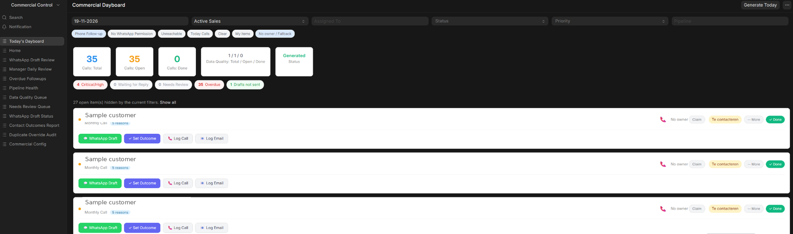
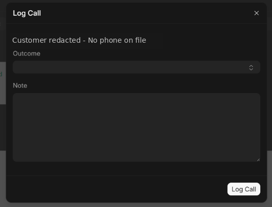
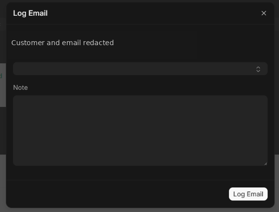
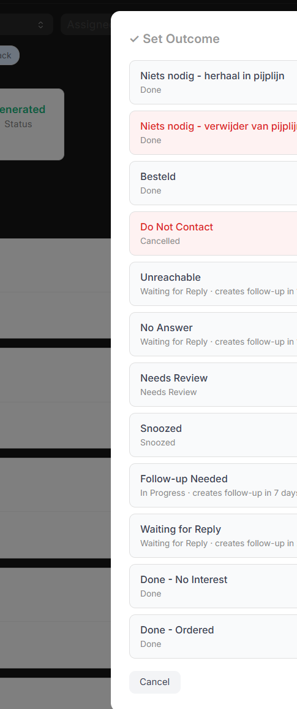
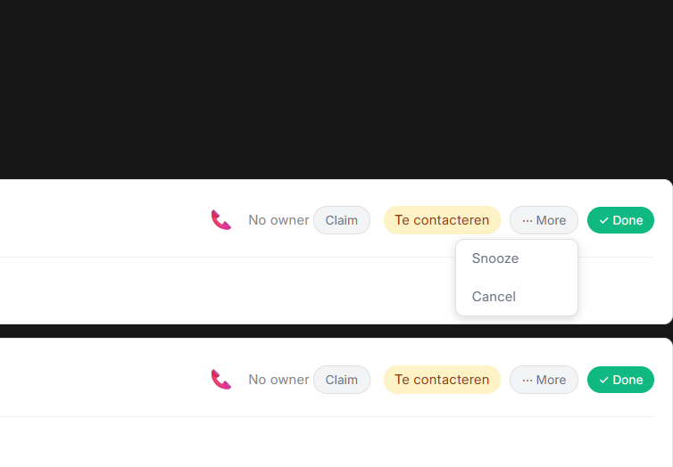

# CRM Dayboard: Sales User Guide

**Audience:** Carnivale staff with the **Commercial Sales User** role.  
**Verified from:** `commercial_control_tower/page/dayboard`, associated APIs, and the supplied screenshots. The on-screen labels below match the UI.

## On this page

- [Open and filter the Dayboard](#open-and-filter-the-dayboard)
- [Understand the numbers and colors](#understand-the-numbers-and-colors)
- [Claim work and review every reason](#claim-work-and-review-every-reason)
- [Log a phone call](#log-a-phone-call)
- [Log an email](#log-an-email)
- [Select and apply an outcome](#select-and-apply-an-outcome)
- [Complete, snooze or cancel an item](#complete-snooze-or-cancel-an-item)
- [Handle follow-ups and duplicate warnings](#handle-follow-ups-and-duplicate-warnings)
- [Follow company contact rules](#follow-company-contact-rules)

## Open and filter the Dayboard

**Open directly:** [Today's Dayboard](https://carnivale.frappe.cloud/app/dayboard) in ERPNext Desk. The Date, board type and filters are on this page.

1. In ERPNext Desk, open **Commercial Control Tower → Today's Dayboard**.
2. Set the **Date** and select **Active Sales** or **Prospect Onboarding**. These boards are separate.
3. Check the status of generation. The source schedules daily generation at approximately **04:00**, using the ERPNext site timezone (Europe/Brussels).
4. Use the upper selectors: **Assigned To**, **Status**, **Priority** and **Pipeline**.
5. Use the quick filters **Phone Follow-up**, **No WhatsApp Permission**, **Unreachable**, **Today Calls**, **My items** and **No owner / Fallback**.
6. If you see **open item(s) hidden by the current filters**, select **Show all** or clear the relevant filters. Hidden does not mean completed.

The code initially filters the screen to the active working statuses **Open**, **In Progress** and **Needs Review**. To inspect completed, contacted, waiting or snoozed items, change the status filter or show all.

**Screenshot: Dayboard overview.** Shows the date, board type, counts, quick filters, and each customer's available actions. All customer names are masked.

## Understand the numbers and colors

The upper cards separate **Calls: Total / Open / Done**, **Data Quality: Total / Open / Done**, and the board generation status.

Below them are live indicators for **Critical/High**, **Waiting for Reply**, **Needs Review**, **Overdue** and **Drafts not sent**. Values in the screenshot are from a historical example, not a live report.

A colored dot beside the customer's name indicates contact reachability. Green indicates within known opening hours, orange indicates outside or near an opening-hours window, red indicates a closure or do-not-contact situation, and grey indicates insufficient data. **Do not contact a red/do-not-contact account without an authorized review.**

The card can show a customer, pipeline, **reason count**, suggested channel, owner, stage and priority. Select the card's body to inspect the complete **Commercial Dayboard Item**, including its reasons.

## Claim work and review every reason

**Open directly:** [Dayboard customer work queue](https://carnivale.frappe.cloud/app/dayboard), then select the appropriate card.

A Dayboard Item represents one customer on one date and may have several reasons. Open the item to review the specific pipelines, follow-up or data-quality problems before contacting anyone.

- **Claim** appears for eligible items shown as without a real owner, meaning assigned to the fallback owner.
- **My items** shows work assigned to the current user.
- **No owner / Fallback** exposes items that would otherwise be overlooked.
- The customer card's stage label, such as **Te contacteren**, is a presentation label, not always the underlying technical status.

If a task belongs to someone else, use the authorized assignment/reassignment process rather than duplicating the contact.

## Log a phone call

**Open directly:** [Today's Dayboard](https://carnivale.frappe.cloud/app/dayboard), select a customer card, then **Log Call**. The button does not place a phone call.

1. Select **Log Call** on the customer card.
2. Verify the contact and phone number. The dialog shows **No phone on file** when absent.
3. Make the call outside the app. The button itself does not place a call.
4. Select an **Outcome**, enter a clear **Note**, and set **Follow-up Date** if applicable.
5. Select **Log Call** to register the **Commercial Contact Moment** and apply the chosen outcome when provided.
6. Confirm the board refreshed and check whether another follow-up was created.

**Screenshot: Log Call dialog.** The actual UI displays a contact number when available, an outcome selector and notes. A missing phone number is not a valid reason to invent one.

## Log an email

**Open directly:** [Today's Dayboard](https://carnivale.frappe.cloud/app/dayboard), select the card's **Log Email** action.

1. Select **Log Email**.
2. Verify the recipient's email. If none is on file, correct the contact data first.
3. Send the email through the organization's approved email service.
4. Record the **Outcome**, **Note** and optional **Follow-up Date**.
5. Select **Log Email** to log the interaction.

There is no automatic transactional email template/send workflow in this CRM v1. The form records what happened.

**Screenshot: Log Email dialog.** Customer identity and email have been redacted.

## Select and apply an outcome

**Open directly:** [Today's Dayboard](https://carnivale.frappe.cloud/app/dayboard), then **Set Outcome** on the intended item.

Select **Set Outcome** when you need to record the result of a commercial interaction or a justified status decision. The options come from configured **Commercial Contact Outcome** records, so your current list can differ.

The screenshot includes examples such as **Besteld**, **Niets nodig - herhaal in pijplijn**, **Niets nodig - verwijder van pijplijn**, **Do Not Contact**, **Unreachable**, **No Answer**, **Needs Review**, **Snoozed**, **Follow-up Needed**, **Waiting for Reply**, **Done - No Interest** and **Done - Ordered**.

- **Done** outcomes close the work item.
- **Unreachable / No Answer** may move it to waiting and create a follow-up, according to the configured outcome.
- **Needs Review** sends it for further review.
- **Snoozed** postpones the work.
- **Do Not Contact** is a sensitive decision. Follow management policy.
- **Besteld** is a reported order intention, **not** an ERP-verified Sales Order.

Some outcomes require a note; destructive ones ask for confirmation. A follow-up-causing outcome may warn about an existing open follow-up. Review that warning before choosing an override.

**Screenshot: Set Outcome choices and status effects.** The example also displays the default follow-up delay where applicable.

## Complete, snooze or cancel an item

- **Done:** The card's **✓ Done** action asks for a completion reason and, when required, a note. Use it only for a completed item.
- **More → Snooze:** Choose a future date/time. Snooze is not the same as Done.
- **More → Cancel:** Choose an appropriate cancellation reason. Some reasons require a manager.
- **Claim:** Can be used on fallback-owned, nonfinal work when available.

**Screenshot: More menu.** Shows the **Snooze** and **Cancel** actions beside the normal **Done** control.

**Warning:** A Dayboard Item marked **Done** or **Cancelled** is terminal in the implemented standard flow. Do not close it merely to make the counters look better.

## Handle follow-ups and duplicate warnings

**Open directly:** [Overdue Followups](https://carnivale.frappe.cloud/app/query-report/Overdue%20Followups) · [Needs Review Queue](https://carnivale.frappe.cloud/app/query-report/Needs%20Review%20Queue).

A follow-up can be generated from an outcome or recorded after a real contact. The system checks for matching open work, with a default duplicate warning window of **10 days** in Commercial Settings.

When a duplicate warning appears, choose to open an existing item, cancel the new one, or continue with a **reason**. **Other** requires an explanatory note. A duplicate warning is not a confirmation that a second contact is appropriate.

Follow-up dates are configurable by outcome and may be explicitly selected when the dialog offers that option. Check **Overdue Followups** and **Needs Review Queue** regularly.

## Follow company contact rules

Before reaching out, check the account's **do-not-contact** flag, WhatsApp consent, contact method, closure/holiday period and opening hours. A missing WhatsApp number or undecided consent is a data-quality issue, not authorization to send.

For WhatsApp-specific steps, use the [WhatsApp Draft Workflow](whatsapp-workflow.md). If a task cannot be completed safely, use **Needs Review** or report the data issue instead.

[CRM Dayboard contents](README.md) | [Troubleshooting](troubleshooting.md)
