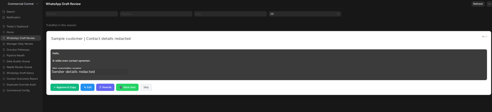
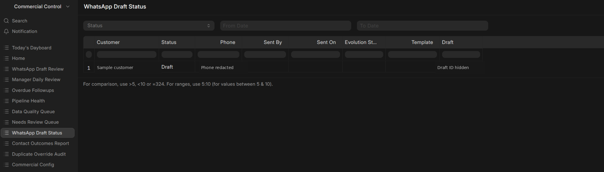

# WhatsApp Draft Workflow

**Audience:** Commercial Sales Users and staff authorized to contact customers.  
**Source checked:** `whatsapp_draft_review.js`, `api/whatsapp.py`, `services/whatsapp_draft_service.py` and the supplied screenshot.

The Carnivale CRM is **draft-only for WhatsApp**. It does **not** automatically transmit messages. A staff member must inspect, send manually through the approved WhatsApp channel, and explicitly record the result.

## On this page

- [Check consent before starting](#check-consent-before-starting)
- [Create a draft from the Dayboard](#create-a-draft-from-the-dayboard)
- [Work through WhatsApp Draft Review](#work-through-whatsapp-draft-review)
- [Approve and copy versus mark sent](#approve-and-copy-versus-mark-sent)
- [What Mark Sent does](#what-mark-sent-does)
- [Skip a draft safely](#skip-a-draft-safely)
- [Audit a draft after contact](#audit-a-draft-after-contact)
- [Rules that must not be bypassed](#rules-that-must-not-be-bypassed)

## Check consent before starting

1. On the Dayboard, open the customer's item and review its reasons and selected contact.
2. Check that the contact has a valid **WhatsApp number** and general WhatsApp consent marked **Yes**.
3. Check any pipeline/channel-specific permission and **do-not-contact** restrictions.
4. If consent or the correct number is missing, do not create or send the draft. Ask the responsible person to fix the data.

The backend checks both the selected contact and current permission when creating a draft and **checks again before Mark Sent**. Consent may have been revoked after the draft was prepared.

## Create a draft from the Dayboard

1. Select **WhatsApp Draft** on an eligible Dayboard Item.
2. The system selects an active template and fills a draft message with permitted customer/contact context.
3. Review the whole text, the phone snapshot, and the recipient.
4. Use the app's **copy message** action or open the approved WhatsApp destination if offered.
5. **Send externally**, then return to the Dayboard to mark it sent.

Do not assume that opening a WhatsApp window or copying the text constitutes delivery.

## Work through WhatsApp Draft Review

Open **Commercial Control Tower → WhatsApp Draft Review**. The screen provides filters for **Owner**, **Pipeline**, **Day**, and **Session Size** (the example shows 20). **Refresh** reloads the pending drafts.

Each card shows the intended customer, phone snapshot, owner/pipeline/date, message, and the actions **Approve & Copy**, **Edit**, **Rewrite**, **Mark Sent** and **Skip**.

**Screenshot: WhatsApp Draft Review.** The customer, phone, sender address and draft identifiers have been hidden for this public wiki.

## Approve and copy versus mark sent

**Approve & Copy** copies the visible textarea text to your clipboard. It does **not** send WhatsApp, and it does not mark the draft as Sent.

**Edit** focuses the text field for a manual adjustment. **Important implementation limit:** In the reviewed JavaScript, editing the textarea and choosing Approve & Copy **does not save the edited text back to the WhatsApp Draft record**. Do not assume your edited copy is permanently preserved in the CRM. If exact message archiving is required, record it through the approved contact-note procedure and ask the development team to close this gap.

**Rewrite** regenerates the draft from the current template and source data, replacing the draft body on the server. Read the new wording fully before using it.

Once the recipient and copy are approved, paste the text into the **approved WhatsApp account**, check the number and send manually.

Only **after you have actually sent the message**, select **Mark Sent** and confirm.

## What Mark Sent does

On Mark Sent, the server checks the draft status, current consent, and phone snapshot against the present contact number. If the contact number changed, the UI offers **Update Number & Send**, **Send Anyway**, or cancelling the action.

A successful Mark Sent operation records the draft as **Sent**, locks it from editing and creates a **Commercial Contact Moment**. It is designed to avoid duplicate sent records on retry.

The wording of the warning's button does not imply that the server transmits WhatsApp. You must already have completed the external send. If consent was withdrawn, the server blocks marking the draft as sent; escalate the case rather than bypassing it.

For delivery reminder pipelines, repeat WhatsApp contact in the same calendar week can trigger a duplicate warning with an auditable override reason.

## Skip a draft safely

1. Select **Skip** for a draft you are not sending.
2. Choose a reason such as **Not the right time**, **Wrong message/template**, **Customer contacted elsewhere**, **Needs manager review**, **No longer relevant** or **Other**.
3. Enter a note when **Other** is selected.
4. Confirm Skip.

**Important:** The implemented `skip_draft` records the reason but leaves the WhatsApp record in **Draft** and **does not change the Dayboard Item's status**. The item may remain visible in the pending queue. To actually resolve the work, use a separate authorized outcome, snooze or manager review. Skip is not a substitute for contact logging.

## Audit a draft after contact

Use **WhatsApp Draft Status** to filter the record list by status and dates. Review **Sent By** and **Sent On** where applicable. If it remains **Draft**, the CRM does not consider it sent regardless of what may have happened in a separate WhatsApp client.

**Screenshot: WhatsApp Draft Status.** The status, sent fields, template and audit reference are visible; personal details are hidden.

## Rules that must not be bypassed

- No automated WhatsApp delivery in v1.
- No consent, no message. A contact's number or permission can change between draft creation and sending.
- Do not click **Mark Sent** merely to remove a pending task.
- Do not treat **Approve & Copy** as an audit-approved message send.
- Do not attach live WhatsApp numbers, customer messages or template personalization in public bug reports.
- Escalate uncertain recipients, restricted contacts or duplicate reminders to the authorized manager.

[CRM Dayboard contents](README.md) | [Sales User Guide](sales-user-guide.md) | [Reports](reports.md)
