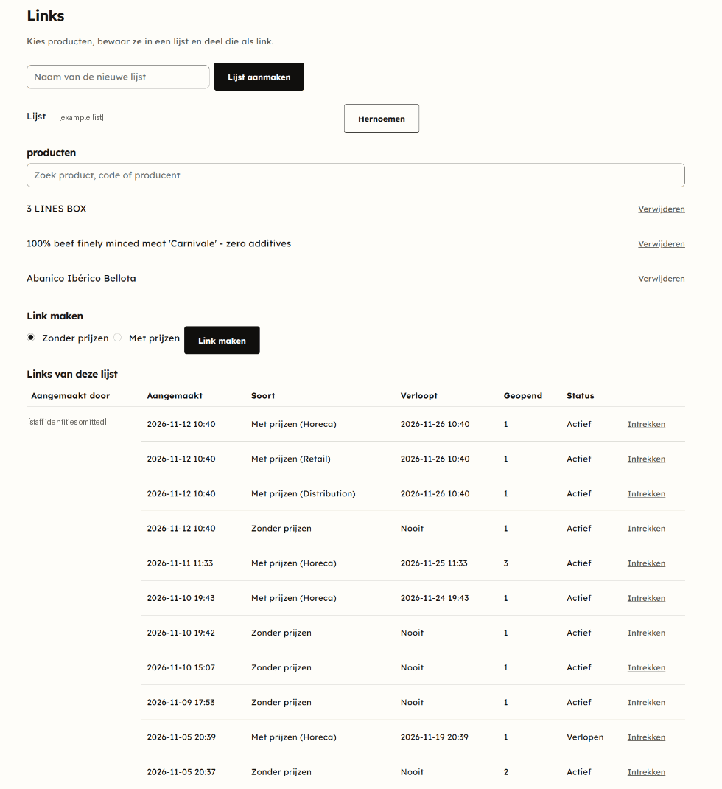

# Carnivale B2B Order App: Administrator Guide

**For:** Carnivale sales management, authorized catalog managers, ERPNext system administrators and colleagues responsible for customer onboarding.  
**Source checked:** `ERPNEXT-MORABEZA/carnivale-b2b`, particularly `b2b-v5-release-2`, its ERPNext DocTypes and permission checks, plus supplied screenshots dated 19 November 2026.  
**Important:** The B2B order app is mainly a **customer-facing portal**. Many administrative actions happen in **ERPNext Desk**, not in the customer portal. The only directly pictured B2B administration page is **Links**. Never assume a screen or role is enabled in production until confirmed.

## On this page

- [1. Understand the administrative roles](#1-understand-the-administrative-roles)
- [2. Onboard a new B2B customer](#2-onboard-a-new-b2b-customer)
  - [Create or verify the Customer](#create-or-verify-the-customer)
  - [Set up delivery weekdays](#set-up-delivery-weekdays)
- [3. Maintain the product catalog in ERPNext Desk](#3-maintain-the-product-catalog-in-erpnext-desk)
  - [Product visibility and categorization](#product-visibility-and-categorization)
  - [Maintain product prices](#maintain-product-prices)
  - [Pre-orders, delivery lead times and new products](#pre-orders-delivery-lead-times-and-new-products)
- [4. Configure delivery rules and ordering behavior](#4-configure-delivery-rules-and-ordering-behavior)
  - [B2B Settings](#b2b-settings)
  - [Territory delivery rules](#territory-delivery-rules)
  - [Test a change before rollout](#test-a-change-before-rollout)
- [5. Process portal orders in ERPNext Sales Orders](#5-process-portal-orders-in-erpnext-sales-orders)
  - [Customer-visible order statuses](#customer-visible-order-statuses)
- [6. Manage shareable product lists and Links](#6-manage-shareable-product-lists-and-links)
- [7. Import and enrichment policy](#7-import-and-enrichment-policy)
- [8. Manage account security and access](#8-manage-account-security-and-access)
- [9. Operations and go-live checklist](#9-operations-and-go-live-checklist)

## 1. Understand the administrative roles

| Responsibility | Relevant permission / interface |
| --- | --- |
| Customer ordering | Portal account linked to an ERPNext **Customer** |
| Product catalog and B2B item prices | **B2B Catalog Manager**, with the correct scoped User Permissions |
| Customer master data and Sales Order review | Appropriate native ERPNext roles, granted by the system administrator |
| Territory-specific B2B delivery rules | **Sales Manager** or **System Manager** on B2B Delivery Rule |
| Global B2B Settings | **System Manager** |
| Shared product links | **B2B Catalog Manager** or **System Manager** |

**Security rule:** A B2B Catalog Manager is intentionally narrower than the stock Item Manager + Sales Master Manager combination. It should not grant access to customer credit settings or unrelated financial records just to edit product content. Admin pages must still enforce authorization server-side.

## 2. Onboard a new B2B customer

**Open in ERPNext Desk:** [Customer records](https://carnivale.frappe.cloud/app/customer) · [User accounts](https://carnivale.frappe.cloud/app/user). Requires the appropriate administrator role.

### Create or verify the Customer

**Open directly:** [Customer list in Desk](https://carnivale.frappe.cloud/app/customer).

1. In ERPNext Desk, open **Customer** using the Desk search.
2. Verify the correct customer name, Customer Group, territory, invoicing and contact information according to Carnivale procedures.
3. Confirm that a valid email/user belongs to this customer. The portal determines customer context through the Customer's linked **portal users**, not just a successful login.
4. Have an authorized administrator create/invite or link the portal user, then test with that non-admin login.
5. Confirm the customer sees only their own account details, cart, favorites and order history.

A login that exists but is not linked to any Customer is sent to **Account not linked to a customer**. Do not fix this by giving a portal user Desk roles.

### Set up delivery weekdays

**Open directly:** [Customer delivery-day settings](https://carnivale.frappe.cloud/app/customer), then open the intended test Customer record.

ERPNext Customer has a **delivery_days** child table of **Commercial Delivery Day** entries. Review each weekday and, when available, its delivery type and order cutoff time. The global fallback is deliberately permissive while some rules are off, but that fallback should not be treated as a final delivery agreement.

When B2B delivery-rule enforcement is enabled, a territory **B2B Delivery Rule** may supply default weekdays, cutoff time and exceptions if customer-specific rows do not override them.

## 3. Maintain the product catalog in ERPNext Desk

**Open in ERPNext Desk:** [Items](https://carnivale.frappe.cloud/app/item) · [Item Prices](https://carnivale.frappe.cloud/app/item-price). These are administrator views, not customer portal pages.

### Product visibility and categorization

1. Search for **Item** and locate it by exact Item Code.
2. Confirm that it belongs to the B2B catalog root **Carnivale Products** or the intended descendant group.
3. Check whether the Item is enabled and available for portal display.
4. Maintain the product name, image, description, brand/producer, Item Group, category/tag fields, origin and applicable product labels.
5. Check stock UOM and other allowed sales units before assigning prices.
6. Preview the customer catalog with a test customer after saving the Item.

The **Carnivale Products** root is protected against renaming or deletion because the public catalog depends on it. Do not bypass this guard.

### Maintain product prices

**Open directly:** [Item Price records](https://carnivale.frappe.cloud/app/item-price).

1. In Desk, open **Item Price** for the Item.
2. Use **B2B EUR** for the normal B2B catalog price. Check currency, unit, effective dates and selling flag.
3. Save the price and validate the customer-facing result with a separate portal account.
4. For a product that displays **Price on request**, confirm whether it should be excluded from online ordering or supplied with an approved price.
5. Never promise that a prior Sales Order's old rate will be reused for a repeat purchase.

The catalog manager's scoped permissions constrain edits to the B2B catalog Item Group tree and approved price list. The helper that grants this scoped role is an **administrator provisioning task**, not an automatic consequence of assigning a role in the UI. Where the role has not been provisioned correctly, an administrator must apply the approved role and User Permission setup.

### Pre-orders, delivery lead times and new products

Some Items have additional B2B flags or lead time fields. Confirm each Pre-order item's lead time, availability and delivery-day rule before publishing the product. A delivery deadline may display **to be confirmed** when enforcement is off or required data is missing.

**New products** depend on `Item.custom_intro_date` and a configurable window in B2B Settings. A blank intro date does not automatically become today when a product is published. Check the field rather than assuming every newly visible Item appears in the **New products** filter.

## 4. Configure delivery rules and ordering behavior

**Open in ERPNext Desk:** [B2B Settings](https://carnivale.frappe.cloud/app/b2b-settings) · [B2B Delivery Rules](https://carnivale.frappe.cloud/app/b2b-delivery-rule). Settings changes require approval.

### B2B Settings

In ERPNext Desk, search for **B2B Settings**. The application source defines these switches:

| Setting | Default in source | Operational impact |
| --- | --- | --- |
| **Enforce delivery rules** | Off | When on, territory/customer deadlines, holiday logic and eligible dates are enforced |
| **Enforce units** | Off | When on, order units must have valid prices, unit choices can be shown, and stale lines can block checkout |
| **Delivery per product** | Off | When on, products may be grouped by earliest delivery day and checkout can create multiple Sales Orders |
| **Days a product counts as new** | 60 in reviewed branch | Determines the **New products** filter/window; 0 disables the badge/filter, not the Item |
| **Help and contact (sales)** | Empty | Configures customer-facing contact copy |
| **Import: fields Mappa may overwrite** | Empty | Controls which already-filled ERPNext values a legacy import is allowed to replace |

Switching any of the first three options can change what customers see and what orders the system accepts. Do not change them during an active order period without approval and regression tests.

### Territory delivery rules

The **B2B Delivery Rule** DocType contains:

- **Region (Territory)**, which governs matching Customers and sub-territories.
- **Enabled** flag.
- **Deadline time** in the Brussels timezone and lead **business days before delivery**.
- A child table of delivery **weekdays**, optionally with a time-window label.
- **Closed** and **Extra** exception dates.

The application can use the **Carnivale BE** Holiday List to calculate business days when delivery-rule enforcement is active. That Holiday List should be reviewed with the responsible logistics owner.

If rule enforcement is off, the basic delivery window remains available and cutoff fields may be display-only. A visible date or provisional deadline is not a promise that a special delivery request is approved.

### Test a change before rollout

Test a configured customer with regular stock items, a Pre-order item, a blocked/price-on-request item, and at least one boundary date. Confirm that expired deadlines, weekend/holiday logic and grouped delivery behave as intended. Record the before/after state.

## 5. Process portal orders in ERPNext Sales Orders

**Open directly:** [Sales Orders in ERPNext Desk](https://carnivale.frappe.cloud/app/sales-order), for authorized sales staff.

Orders placed online create **ERPNext Sales Order** documents with `order_type = Shopping Cart`, linked to the logged-in Customer.

1. Open **Sales Order** in ERPNext Desk under the appropriate sales role.
2. Identify the new portal order and verify its Customer, Items, quantities, selling prices, delivery date and any line/delivery notes.
3. Review availability, acceptance conditions, applicable taxes and delivery feasibility.
4. Follow Carnivale's approved sales process to submit/confirm the order. The source uses native ERPNext draft/submitted/cancelled document states rather than a separate custom approval workflow.
5. During fulfillment, maintain the standard ERPNext delivery/picking data so customer status changes reflect real progress.

### Customer-visible order statuses

| Portal label | What it represents |
| --- | --- |
| **In controle / Under review** | Draft Sales Order, pending sales-team review |
| **Bevestigd / Confirmed** | Submitted Sales Order |
| **In voorbereiding / In preparation** | Submitted order with picking progress |
| **Geleverd / Delivered** | Submitted order with full delivery percentage |
| **Geannuleerd / Cancelled** | Cancelled Sales Order |

In some configurations, a single checkout can produce **multiple Sales Orders** for different delivery dates, tracked under a B2B Order Request. This is not a duplicate bug. Do not manually delete or re-create orders before checking the request reference.

Checkout includes retry/double-click protection. If a customer reports duplicate submissions, verify the Sales Orders and request records first; do not assume two button clicks created two distinct orders.

## 6. Manage shareable product lists and Links

**Open directly:** [B2B Links, staff portal](https://carnivale.frappe.cloud/b2b/links).

The **Links** page at `/b2b/links` is a **staff-only interface**, not the customer's Favorites feature.

Authorized users can create a product list, add/remove Items, rename it, generate a **Without prices** or **With prices** share link, choose an approved price level, see opening counts and statuses, and revoke a link.

The reviewed system defines three link-specific price lists: **B2B Horeca**, **B2B Retail** and **B2B Distribution**. Price rows must exist and be approved before publishing priced links.

> **Screenshot: Links management.** The example shows list selection, products, link options and the link table. Staff names are removed from the public screenshot pack.
>
> 

See the complete [Shared Links administration guide](shared-links-guide.md) for exact steps, expiration defaults and precautions.

## 7. Import and enrichment policy

The repository's [Import Field Ownership](https://github.com/ERPNEXT-MORABEZA/carnivale-b2b/blob/b2b-v5-release-2/docs/IMPORT_FIELD_OWNERSHIP.md) policy states that existing enriched ERPNext data must not be casually overwritten by Mappa imports.

- Existing fields are filled only if empty by default.
- Already-filled fields are retained unless explicitly allowlisted in B2B Settings.
- **Dry runs** report proposed changes before writing.
- Batches produce change logs and support controlled previews of reverts.
- Product descriptions, weights, units beyond stock UOM, B2B lead times and other enriched fields are ERPNext-owned unless a separate policy permits change.

Import execution and rollback are technical administrator tasks. They are not buttons in the customer ordering portal. Require a dry-run review, approved data ownership, current backup and acceptance before production import.

## 8. Manage account security and access

- Give portal customers only the access needed for their own Customer.
- Use **B2B Catalog Manager** plus scoped User Permissions for product editors, rather than broad commercial/financial roles.
- Allow **Links** only for its authorized staff roles, using server-side checks.
- Never share a customer's cart, order details, private price list, login or one-time share token in a public documentation screenshot.
- Test with two separate customer accounts to confirm isolation of favorites, carts, order history and pricing.
- Keep saved links and other credentials under the organization's normal security policy.

## 9. Operations and go-live checklist

- [ ] Customer users are correctly linked and can log in.
- [ ] Item visibility, categories, images, languages and B2B prices are checked.
- [ ] Pre-order flags, unit prices and product lead days are correct.
- [ ] Customer delivery weekdays and territory rules are approved.
- [ ] B2B Settings switches match the intended release.
- [ ] Normal order, price-on-request error, stale cart and repeat order tested.
- [ ] Sales staff know how to review and submit online Sales Orders.
- [ ] Multi-delivery and duplicate-request behavior tested if enabled.
- [ ] Priced shared links use approved price lists; revoked links cannot be opened.
- [ ] Permissions and customer isolation validated.
- [ ] Screenshots in this public wiki are anonymized and do not disclose private wholesale prices.

[Documentation home](../README.md) | [B2B Order App contents](README.md) | [Shared Links guide](shared-links-guide.md) | [Screenshots](SCREENSHOTS.md)
