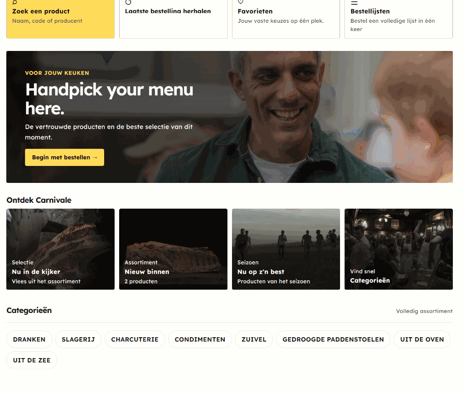
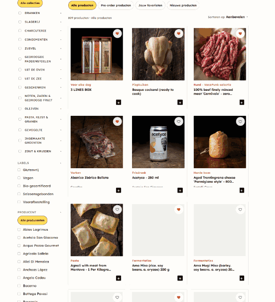
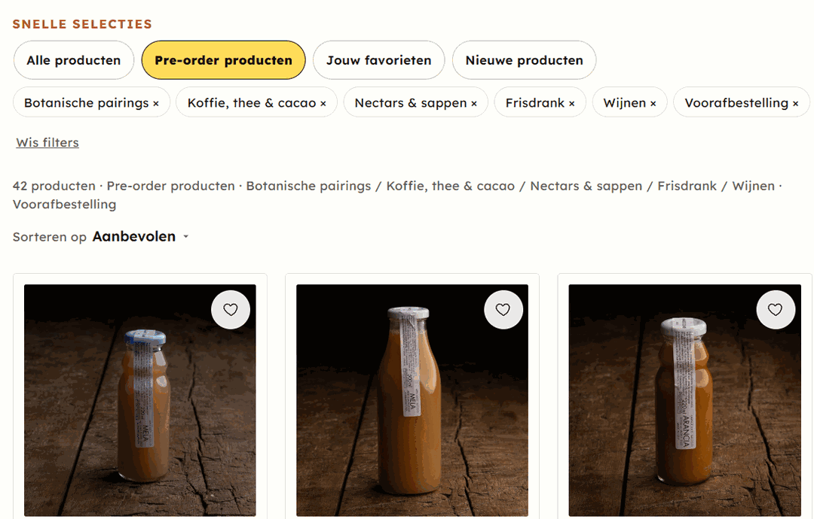
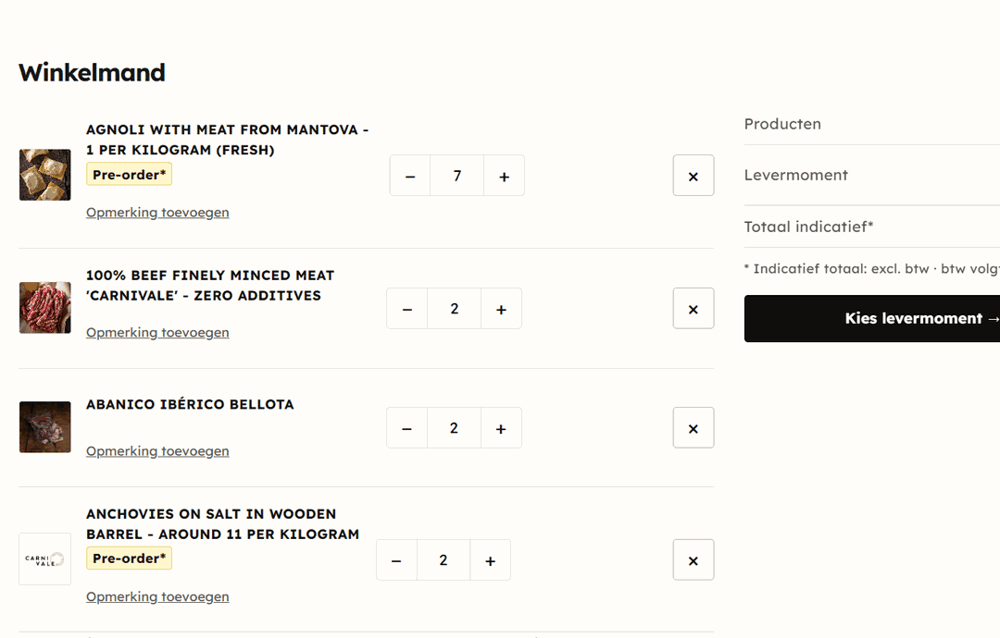
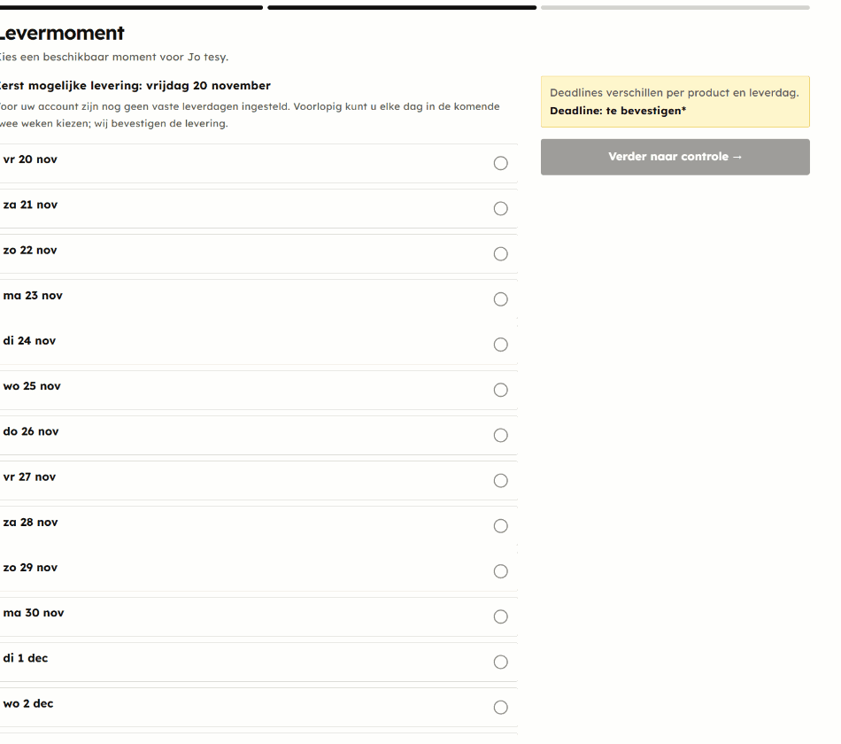
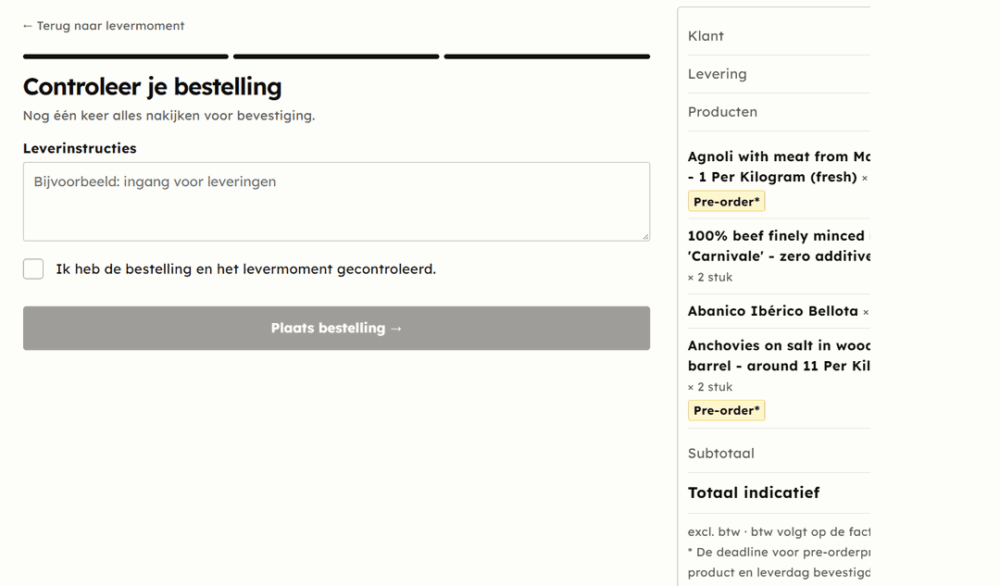
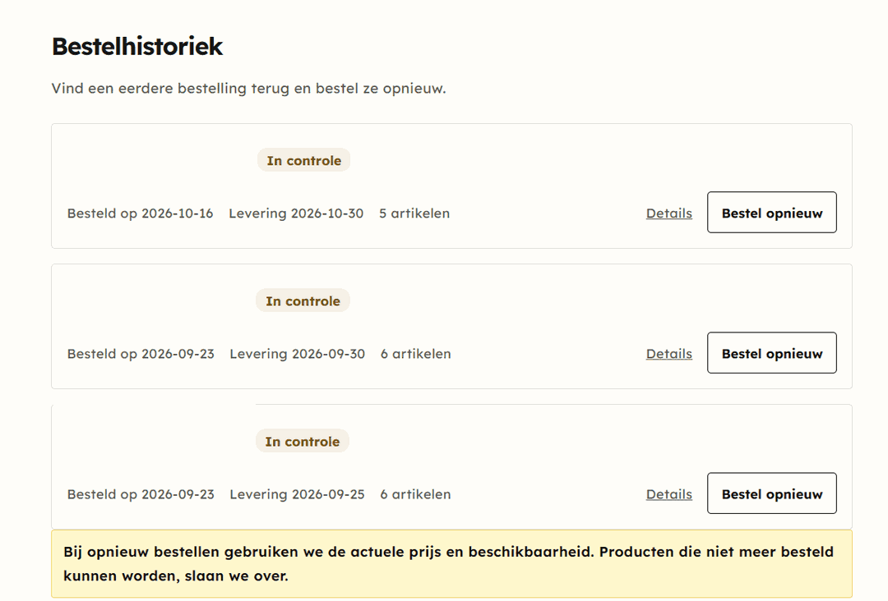
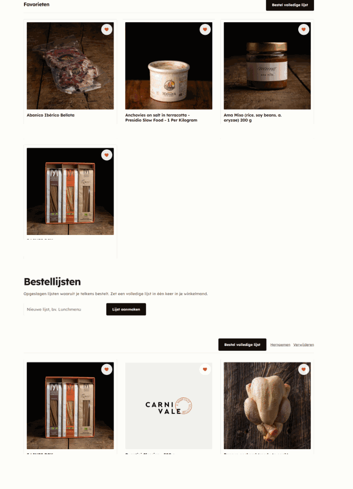

# Carnivale B2B Order App: Customer Guide

**For:** Professional Carnivale customers and people authorized to place orders for their company.  
**Language:** English. The current interface screenshots use Dutch labels, shown in **bold** below.  
**Basis:** Screenshots supplied on 19 November 2026 and the matching `ERPNEXT-MORABEZA/carnivale-b2b` `b2b-v5-release-2` branch. Live configuration and individual catalog visibility can differ between customers.

This guide explains how to search products, build your cart, choose delivery, place an order, repeat earlier orders, and manage favorites and order lists. The *Links* section is intended for authorized Carnivale staff, not ordinary customers.

## On this page

- [1. Sign in, switch language and check your account](#1-sign-in-switch-language-and-check-your-account)
- [2. Start from Home](#2-start-from-home)
- [3. Find products in the catalog](#3-find-products-in-the-catalog)
  - [Understand product cards and prices](#understand-product-cards-and-prices)
- [4. Add items and use the cart](#4-add-items-and-use-the-cart)
- [5. Choose your delivery moment](#5-choose-your-delivery-moment)
- [6. Review and place the order](#6-review-and-place-the-order)
  - [What happens after you place it?](#what-happens-after-you-place-it)
- [7. Find your order history and repeat an order](#7-find-your-order-history-and-repeat-an-order)
- [8. Save favorites and reusable order lists](#8-save-favorites-and-reusable-order-lists)
  - [Favorites](#favorites)
  - [Order lists](#order-lists)
- [9. Check your account and delivery-day details](#9-check-your-account-and-delivery-day-details)
- [10. Common problems](#10-common-problems)

## 1. Sign in, switch language and check your account

**Open directly:** [B2B sign-in](https://carnivale.frappe.cloud/b2b/login) · [My account](https://carnivale.frappe.cloud/b2b/account).

1. Visit [Carnivale B2B](https://carnivale.frappe.cloud/b2b).
2. If you are not signed in, choose **Aanmelden / Log In** and enter your customer login.
3. Choose **NL**, **FR** or **EN** in the top bar. Availability of a translation does not change product codes or prices.
4. Check the yellow customer/delivery strip near the top. **Wijzig / Change** leads to the delivery selection when you are ordering.
5. Use **Afmelden / Log Out** when finishing on a shared device.

Your login must be linked to a Carnivale **Customer** account to view customer-specific ordering features. If you see **Account not linked to a customer**, ask Carnivale to connect your login. Do not borrow someone else's account.

## 2. Start from Home

**Open directly:** [B2B homepage](https://carnivale.frappe.cloud/b2b).

The Home page shows quick actions for searching products, repeating the latest order (if you have one), favorites and order lists (when used). It may also show a seasonal banner and product/category highlights.

1. Choose **Zoek een product / Search for a product** to browse the assortment.
2. Choose **Laatste bestelling herhalen / Repeat last order** to reopen a previous basket.
3. Choose **Favorieten / Favorites** or **Bestellijsten / Order lists** for products you purchase regularly.
4. Select a category or **Begin met bestellen / Start ordering** to open the catalog.

Some homepage blocks depend on available content, saved lists, previous orders and campaign settings. Not seeing a card does not necessarily mean something is broken.

**Screenshot: customer homepage.** It shows the quick actions, featured banner and category shortcuts.

## 3. Find products in the catalog

**Open directly:** [Product catalog](https://carnivale.frappe.cloud/b2b/catalog) · [Pre-order products](https://carnivale.frappe.cloud/b2b/catalog?is_pre_order=1).

Open **Bestel / Order** or [the catalog](https://carnivale.frappe.cloud/b2b/catalog). The header search can look up a product name, code or producer.

Use the left sidebar and quick selection buttons to narrow the assortment:

- **Collecties / Collections**, including subcategories.
- **Labels / Tags** and **Producent / Producer**.
- **Herkomst / Origin** and available product condition filters.
- **Alle producten / All products**, **Pre-order producten**, **Jouw favorieten**, and **Nieuwe producten**.
- The **Sorteren op / Sort by** dropdown and page navigation.
- **Wis filters / Clear filters** to start over.

Several categories, producers or origins can be selected together. Check the active filter chips above the product cards so you do not accidentally hide a product. On a phone, use the filters panel and its **Apply filters** action if shown.

**Screenshot: catalog browsing.** It shows categories, product cards, quick selections and product filters.

**Screenshot: pre-order filter.** The yellow quick selection and applied filter chips narrow the visible products.

### Understand product cards and prices

A product card may show a photo, item name, producer, product labels, price per unit and an **Add (+)** action. Select the product to view its details before ordering if you need more information.

Prices shown in the B2B portal are generally **excluding VAT**. A price marked **Price on request** cannot be added to an online order through the normal cart until a valid orderable price exists.

Some products show **Pre-order**. Their cutoffs may differ by product and delivery day. A label alone does not guarantee the same deadline for every item.

When available, an item may have more than one orderable unit. Check the unit beside the quantity/price before adding to your cart.

## 4. Add items and use the cart

**Open directly:** [Winkelmand, shopping cart](https://carnivale.frappe.cloud/b2b/cart).

1. Select a product's **+** button to add it, or open its detail page.
2. Use the cart icon in the header to open **Winkelmand / Cart**.
3. Review each item and the displayed quantity. Use **−** and **+** or edit the number.
4. Choose **×** to remove an unwanted line.
5. Select **Opmerking toevoegen / Add comment** for an item-specific instruction. Save it by leaving the comment field when the application confirms the change.
6. Review any **Pre-order** warnings and the indicative amount **excl. btw / excluding VAT**.
7. Continue with **Kies levermoment / Choose delivery moment**.

The cart can show **Apply changes** if a product price, available unit or orderability changed while you were ordering. Review the new information and apply the changes before continuing. Do not ignore a blocked product.

**Screenshot: cart.** It highlights line quantities, item comments, remove buttons and the delivery step.

## 5. Choose your delivery moment

**Open directly:** [Levermoment, delivery selection](https://carnivale.frappe.cloud/b2b/delivery). Start from your cart when placing a new order.

After leaving the cart, the separate **Levermoment / Delivery moment** page presents available dates. In the supplied screenshot, a customer without a fixed delivery rule sees a provisional earliest date and a list of selectable dates.

1. Check **Eerst mogelijke levering / Next possible delivery**.
2. Select one of the available date options.
3. Read the warning about product-specific deadlines and whether a deadline is still **te bevestigen / to be confirmed**.
4. Choose **Verder naar controle / Continue to review** after selecting a valid date.

If a customer has approved delivery weekdays or territory delivery rules, only eligible dates are offered. The normal selection window is up to 14 days in the reviewed code, but business constraints, holidays and cutoff rules may narrow that list.

Where **delivery per product** is enabled, products can be grouped into several delivery dates. You can move an eligible group later, not earlier than its earliest valid date, and the checkout may create **one Sales Order per delivery day**. This grouped mode is a system setting, not something every customer necessarily sees.

**Screenshot: delivery selection.** It shows available dates and a warning that deadlines may need confirmation.

## 6. Review and place the order

**Open directly:** [Checkout review](https://carnivale.frappe.cloud/b2b/checkout), after selecting a valid delivery date. This link does **not** submit an order.

The **Controleer je bestelling / Review your order** page summarizes the customer, selected delivery date, products, quantities and indicative total.

1. Check the number of items and product units against what you intended.
2. Review the delivery date and product-specific **Pre-order** labels.
3. Optionally add **Leverinstructies / Delivery instructions**, such as a receiving entrance. These are for the delivery, separate from comments on individual product lines.
4. Tick **Ik heb de bestelling en het levermoment gecontroleerd / I have checked the order and delivery moment**.
5. Select **Plaats bestelling / Place order**. The button is disabled until the required review is complete.
6. Wait for the order confirmation and note your order reference.

**Screenshot: final review.** It shows delivery instructions, the required confirmation checkbox and the summary.

### What happens after you place it?

The system creates an ERPNext **Sales Order**. In the order history, the initial status can be **In controle / Under review**, which means Carnivale has not yet completed its sales-team review. This is **not** proof that your order was already accepted, paid or delivered.

The portal uses these labels when applicable: **Under review**, **Confirmed**, **In preparation**, **Delivered**, or **Cancelled**. Final prices, taxes and acceptance are determined by the business's normal order process.

The screenshots do **not** show an online payment step. Do not assume that pressing Place Order pays the invoice.

## 7. Find your order history and repeat an order

**Open directly:** [Bestelhistoriek, order history](https://carnivale.frappe.cloud/b2b/account/orders).

Open **Bestelhistoriek / Order History** from the top menu or through **Mijn account / My Account**.

For each order, you can review the order date, planned delivery date, number of items, indicative amount excluding VAT, and current status.

1. Select **Details** to inspect line items.
2. Choose **Bestel opnieuw / Repeat Order** to prepare a repeat purchase.
3. Review the repeat preview and any products that cannot be ordered.
4. Check the cart again, then select a new delivery moment and complete checkout normally.

**Important:** Repeating a previous order uses **today's prices and availability**, not the old order's price. Products that are no longer orderable, have changed units or require a quote may be omitted. A repeat action does not automatically submit an order without the normal checkout.

**Screenshot: order history.** The historical order cards have Details and Repeat Order actions.

## 8. Save favorites and reusable order lists

**Open directly:** [Favorieten, favorites](https://carnivale.frappe.cloud/b2b/account/favorites) · [Bestellijsten, saved order lists](https://carnivale.frappe.cloud/b2b/account/favorites#b2b-order-lists).

Open **Favorieten / Favorites** from the account menu or homepage.

### Favorites

Select the **heart** icon on a product card to save an item. The Favorites page brings your saved products together for quick ordering. Choose the heart again to remove an item.

### Order lists

The same page includes **Bestellijsten / Order lists** for groups of frequently purchased products:

1. Enter a new list name and select **Lijst aanmaken / Create list**.
2. Add the relevant products using their favorite/list controls.
3. Open the saved list, then use **Bestel volledige lijst / Order whole list** to add its products to the cart.
4. Select **Hernoemen / Rename** or **Verwijderen / Delete** to maintain a list.

The list action adds orderable products to your cart; you still need to review quantities and proceed through delivery and checkout. Availability and current prices are checked again.

**Screenshot: favorites and saved order lists.**

## 9. Check your account and delivery-day details

**Open directly:** [Mijn account](https://carnivale.frappe.cloud/b2b/account) · [Delivery selection](https://carnivale.frappe.cloud/b2b/delivery) · [Help and contact](https://carnivale.frappe.cloud/b2b/account/help).

Open **Mijn account / My Account** to access Favorites, Cart, Order History, and your configured delivery weekdays. If fixed delivery days are missing, the portal may allow a provisional date choice and explain that Carnivale will confirm delivery.

Do not try to edit company-level delivery rules from the customer account. Contact Carnivale if your assigned customer, delivery schedule, or address is incorrect.

## 10. Common problems

| Problem | What to check |
| --- | --- |
| Login works but ordering is unavailable | Your user may not be linked to a Customer account |
| Product does not appear | Remove filters and check search spelling or product code |
| **+** is disabled or price says **on request** | The product does not have an orderable online price |
| Selected quantity or price changes | Follow the cart's **Apply changes** prompt, then review again |
| **Continue** is disabled | Choose an eligible delivery date and resolve blocked items |
| **Place order** is disabled | Tick the review confirmation and resolve any cart warnings |
| A repeated order has fewer items | Some lines were unavailable, changed unit or could not be priced |
| Old order says **Under review** | The sales team has not yet confirmed it |
| A feature or date is different from this guide | Some functions depend on current B2B Settings and customer delivery rules |

For additional explanations, see [Troubleshooting](troubleshooting.md). If the issue continues, contact Carnivale with the screen name, approximate time, and order reference. Never send your password.

[Documentation home](../README.md) | [B2B Order App contents](README.md) | [Customer screenshot checklist](SCREENSHOTS.md)
