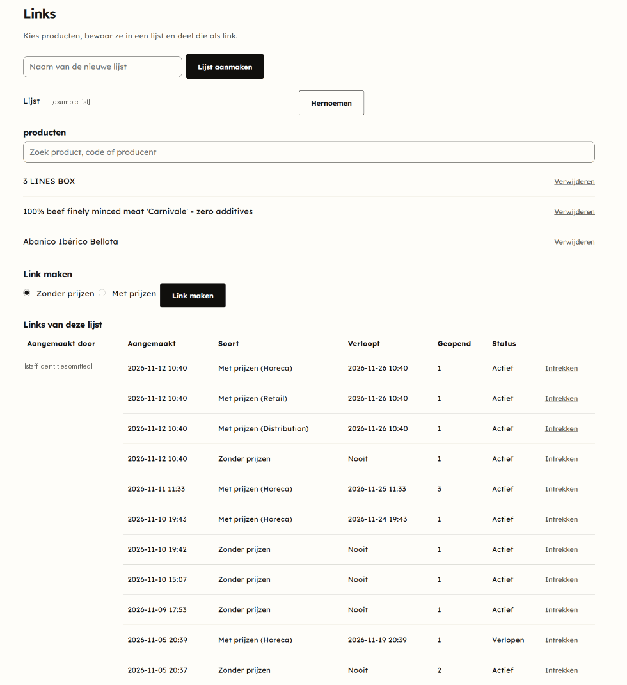

# Shared Product Links: Administrator Guide

**Audience:** Carnivale staff with **B2B Catalog Manager** or **System Manager** access.  
**Source:** Deployed page screenshot dated 19 November 2026, `carnivale_b2b/www/b2b/links`, `api/share_links.py` and `docs/SHARE_LINKS_DECISIONS.md` on the reviewed `b2b-v5-release-2` branch.

This feature creates shareable product-selection pages. It is **not** a customer checkout, and it is **not** the same as customers' Favorites or Order lists.

## On this page

- [1. Open Links and create a list](#1-open-links-and-create-a-list)
- [2. Add products and rename the list](#2-add-products-and-rename-the-list)
- [3. Generate a link with or without prices](#3-generate-a-link-with-or-without-prices)
- [4. Understand expiry and link status](#4-understand-expiry-and-link-status)
- [5. Revoke a link](#5-revoke-a-link)
- [6. Security and troubleshooting](#6-security-and-troubleshooting)

## 1. Open Links and create a list

**Open directly:** [B2B Links, staff-only product sharing](https://carnivale.frappe.cloud/b2b/links). This is not accessible to ordinary customer accounts.

1. Sign in with an authorized staff account.
2. Select **Links** in the B2B navigation, or open [Links](https://carnivale.frappe.cloud/b2b/links).
3. Enter a descriptive name in **Naam van de nieuwe lijst / New list name**.
4. Select **Lijst aanmaken / Create list**.
5. Select your list from the dropdown if you have several lists.

If **Links** is not visible, verify your assigned role. The server checks role permissions on every list and link action. The page must not be exposed simply by guessing its URL.

## 2. Add products and rename the list

1. Select the desired list.
2. Search under **Producten / Products** by name, code or producer.
3. Add the correct products and review the resulting list.
4. Select **Verwijderen / Remove** beside a product to remove it from that list.
5. To change its title, edit the name and choose **Hernoemen / Rename**.

The management page is list-based. A share link later shows only products still visible in the allowed catalog. A deactivated or hidden product may disappear from a shared view.

**Screenshot: list editor and product search.** Staff names, customer context and URLs have been obscured in the prepared image.

## 3. Generate a link with or without prices

1. Under **Link maken / Make link**, choose **Zonder prijzen / Without prices** or **Met prijzen / With prices**.
2. If choosing **With prices**, select the intended approved level: **B2B Horeca**, **B2B Retail** or **B2B Distribution**.
3. Select **Link maken / Make link**.
4. Use **Kopieer link / Copy link** **immediately** and store it safely for the intended recipient.
5. Share it only with the approved audience.

The application deliberately displays the raw share URL **only once**. It stores a hash of the token, not the token itself, and therefore cannot recreate the identical link later. If the link is lost, create a new one.

A link with prices uses the chosen link price list, not the viewing user's logged-in customer pricing. Verify the chosen tier and the actual Item Price rows before sharing.

## 4. Understand expiry and link status

**Open directly:** [Links and issued-link status](https://carnivale.frappe.cloud/b2b/links), after signing in with an authorized staff role.

The source's default expiry policy is:

| Mode | Default validity |
| --- | --- |
| **With prices** | 14 days |
| **Without prices** | Never expires automatically |

Administrators can adjust these defaults in server-side configuration; confirm the active site policy before making a commercial promise.

The table **Links van deze lijst / Links of this list** shows who created each link, when, its mode/price level, expiry, open count, and whether it is **Actief**, **Verlopen** or revoked.

The public link opens a read-only product page. Recipients do not need a B2B customer login to view an authorized shared list, but they do not receive customer checkout access through that link. The recipient needs JavaScript enabled.

## 5. Revoke a link

1. Find the link in **Links van deze lijst**.
2. Check that the list, creation date and mode match the intended link.
3. Select **Intrekken / Revoke**.
4. Confirm the warning that the link will stop working immediately.
5. Verify its status has changed.

Revocation is recorded for audit. The source prevents deleting a link record directly and avoids deletion of a product list that still has issued links.

## 6. Security and troubleshooting

- **Incorrect price level:** Revoke the link and make a new one. Do not reuse a link that exposed an unintended price list.
- **Link cannot be copied again:** This is by design. The raw token is shown only after creation.
- **Expired link:** Generate a replacement and share the new URL.
- **Unknown or revoked link:** The public page displays a generic invalid state without revealing which condition occurred.
- **Product missing from shared view:** Check whether the Item is active, in the allowed catalog subtree and priced in the chosen list.
- **Public link passed around:** Anyone holding a valid token can open it. Revoke it if shared too widely.
- **Language changed:** The app preserves the link token while switching NL/FR/EN, as specified.

Do not paste live links, access tokens or confidential price levels into public issue reports or screenshots.

[Administrator guide](admin-guide.md) | [B2B Order App contents](README.md)
