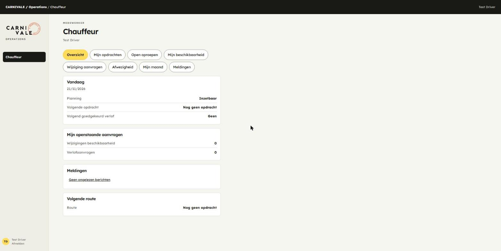
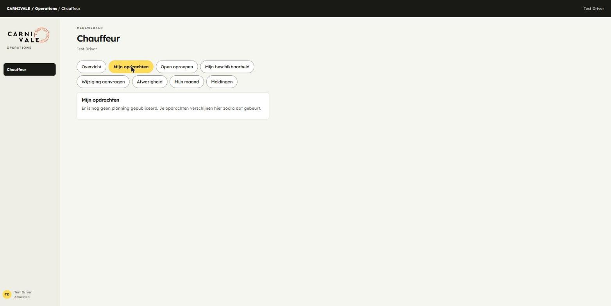
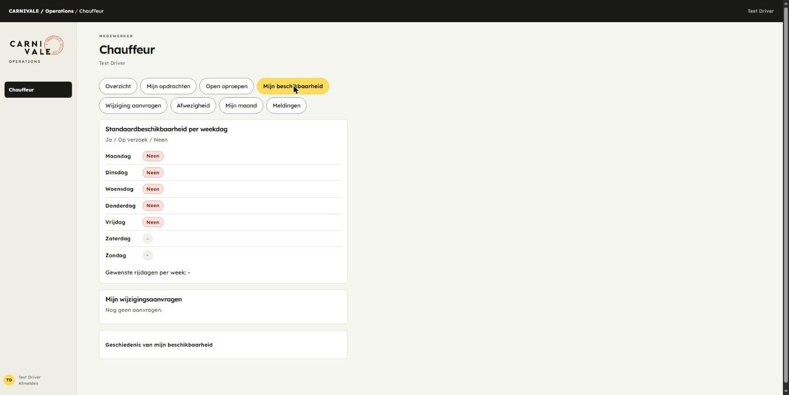
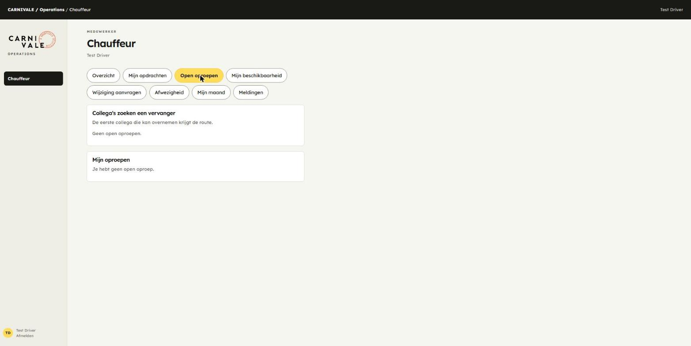

# Driver guide

**Audience:** Geofood delivery drivers.  
**Status:** Implementation-based draft. The mobile screens and production feature switches require verification before this becomes a live step-by-step user manual.

This page explains what the Driver App is intended to let a driver do. Specific button labels, menu positions and phone URLs must be added after a controlled test.

## On this page

Select a section to jump directly to it.

- [1. Get your driver access](#1-get-your-driver-access)
- [2. Check your published plan](#2-check-your-published-plan)
- [3. Report availability or request leave](#3-report-availability-or-request-leave)
- [4. Respond to a replacement request](#4-respond-to-a-replacement-request)
- [5. Register your workday](#5-register-your-workday)
- [6. Check the vehicle and record the odometer](#6-check-the-vehicle-and-record-the-odometer)
- [7. Report damage or an incident](#7-report-damage-or-an-incident)
- [8. View your dossier and required reading](#8-view-your-dossier-and-required-reading)
- [9. Notifications](#9-notifications)
- [Before using this as a live guide](#before-using-this-as-a-live-guide)

## 1. Get your driver access

An administrator must first ensure that an Employee record and Driver Profile exist, that required details and availability are complete, and that your separate driver login has been approved.

The profile creation process does **not** automatically create a login. If you cannot sign in, contact the administrator. Do not use a colleague's credentials.

> **Screenshot to add:** Show the actual signed-in driver dashboard on a phone, with a test account and no real personal information.
> **File to upload:** `driver-app/images/driver-home.png`

## 2. Check your published plan

The backend supports a driver-specific view of **published**, non-cancelled assignments. A driver should be able to review their own scheduled work and assigned route information, not another driver's full plan.

**Once the phone screen is verified, document:**

1. How to open the published plan.
2. Where the assigned date, start time and route are displayed.
3. How a changed assignment is highlighted.
4. Where the driver sees the most recent route information sheet.

A planning draft or shadow plan must not be treated as published work.

> **Screenshot to add:** Show one published assigned day and its date, route, start and estimated duration.
> **File to upload:** `driver-app/images/driver-published-plan.png`

## 3. Report availability or request leave

The backend supports requests to change availability and to request leave, with an administrator reviewing the result. Approval is required before an availability change affects future plans. A request should not be treated as approved merely because it was submitted.

When the UI is validated, add the exact steps to submit a request and view its status.

> **Screenshot to add:** Show an availability or leave request and its review status.
> **File to upload:** `driver-app/images/driver-availability.png`

## 4. Respond to a replacement request

If you receive a replacement call for an eligible day, the intended workflow allows you to see the offered date, route, start and expected duration, then accept or decline.

The backend ensures that only the first valid acceptance wins when multiple drivers respond. You should verify the final assignment confirmation rather than assuming that tapping Accept guarantees the shift.

**Privacy:** A replacement recipient should not see the identity or private reason of the colleague being replaced.

> **Screenshot to add:** Show a fictional replacement offer and final response status.
> **File to upload:** `driver-app/images/driver-replacement.png`

## 5. Register your workday

When workday tracking is enabled, the backend supports start and end registration, forgotten-end handling and corrected hours. The same general registration process applies to both permanent and flexi drivers.

- Register the start and end of your own workday using the approved interface.
- If a time is incorrect or an end time was forgotten, use the correction/dispute process when it is available, or notify the administrator.
- Do not attempt to register a colleague's hours.

Offline write-back is **off by default** and must be explicitly enabled. Do not assume a registration saved on a disconnected phone has reached the server.

> **Screenshot to add:** Show fictional start/end records and a correction option on the real phone UI.
> **File to upload:** `driver-app/images/driver-workday.png`

## 6. Check the vehicle and record the odometer

The fleet module supports assignment to a vehicle, departure odometer readings with a photo, and vehicle readiness checks.

When enabled and shown in the mobile app, follow the on-screen departure check. Ensure the odometer photo is readable. Do not assume OCR automatically fills the reading: the default OCR provider is **none**, and typed values remain important.

> **Screenshot to add:** Show a test vehicle, numeric odometer field and a photo attachment, with number plates masked.
> **File to upload:** `driver-app/images/driver-odometer.png`

## 7. Report damage or an incident

The backend allows drivers to submit damage reports with photos. The driver may view their own report and status, while internal responsibility assessments stay with administrators.

Record factual details promptly and attach clear evidence through the approved system when enabled. If the function is unavailable during a critical incident stop, follow the administrator's alternative procedure.

> **Screenshot to add:** Show a fictitious damage report form and attached non-identifying photo.
> **File to upload:** `driver-app/images/driver-damage.png`

## 8. View your dossier and required reading

The backend provides driver access to relevant confirmed fines, the driver's own disputes, current logistics manual versions and their required read confirmations. A driver can see their own latest route information sheet via an assignment.

When the interface is released, confirm how to open each of these items and how a required **read confirmation** is submitted.

> **Screenshot to add:** Show an example logistics manual version and an acknowledgment state.
> **File to upload:** `driver-app/images/driver-manual.png`

## 9. Notifications

The application includes in-app notifications and optional email. Push delivery is not assumed active and needs testing on real phones. Check the actual assignment and request status inside the system even when a notification arrives.

## Before using this as a live guide

The screenshots, URLs and exact action labels above are **verification tasks**, not claims that a driver can already find these menus. The app owner must complete the phone acceptance walkthrough first.

[Driver App contents](README.md) | [Administrator guide](admin-guide.md)
