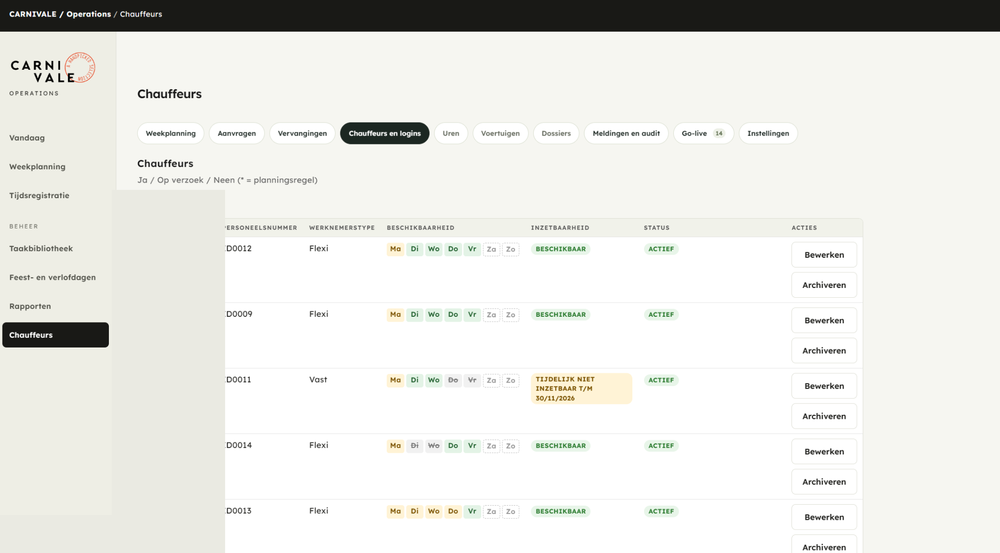
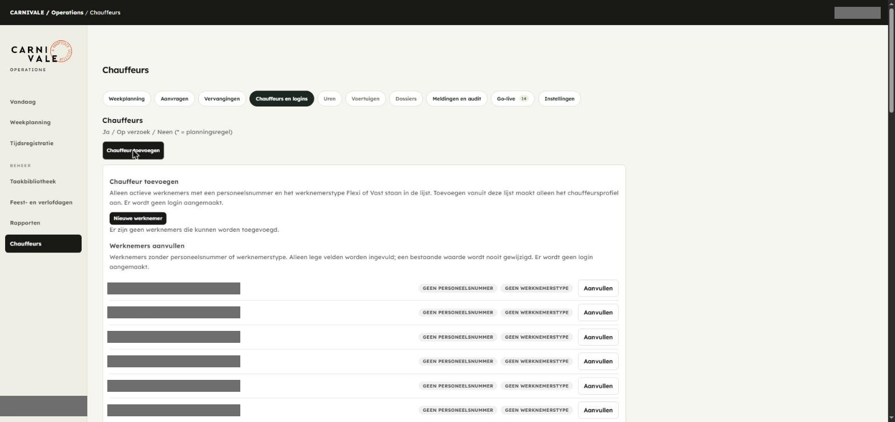
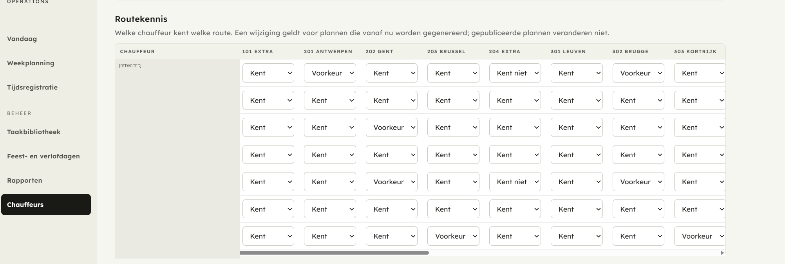
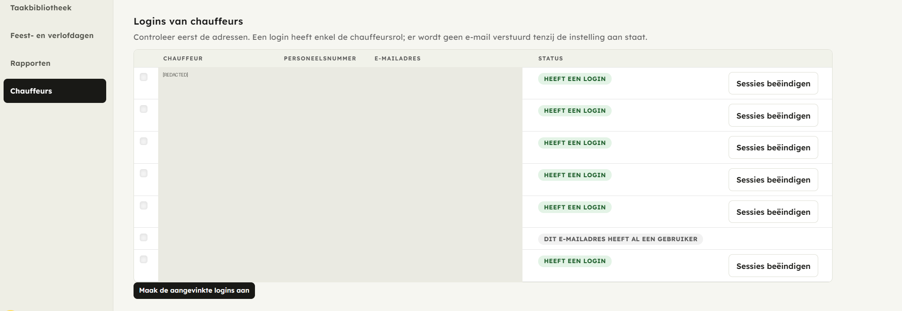

# Driver profiles, route knowledge and logins

**Audience:** Operational Admin.  
**Verification:** Screenshots of the deployed **Chauffeurs en logins** tab plus backend rules, 19 November 2026. Staff data is redacted in the image package for this public wiki.

## On this page

- [Review the driver overview](#review-the-driver-overview)
- [Add or edit a driver](#add-or-edit-a-driver)
- [Maintain route knowledge](#maintain-route-knowledge)
- [Review and create driver logins](#review-and-create-driver-logins)
- [Resolve account readiness issues](#resolve-account-readiness-issues)

## Review the driver overview

**Open directly:** [Chauffeurs en logins, driver roster](https://carnivale.frappe.cloud/taskboard/admin#drivers/drivers).

1. Go to **Chauffeurs** > **Chauffeurs en logins**.
2. Review the driver table with **Naam**, **Personeelsnummer**, **Werknemerstype**, **Beschikbaarheid**, **Inzetbaarheid**, **Status** and **Acties**.
3. Interpret weekday labels as the driver's current availability pattern, not necessarily a confirmed assigned shift.
4. Use the **Bewerken** action for an authorized driver update.
5. Use **Archiveren** only when the driver really should no longer be active; check operational impacts.

The screenshot shows both **Flexi** and **Vast** employee types and examples of **Beschikbaar** versus **Tijdelijk niet inzetbaar** readiness. A driver's profile can be active yet temporarily unavailable for planning.

> **Screenshot: driver overview.** Employee names and personnel numbers are obscured for public documentation.
>
> 

## Add or edit a driver

**Open directly:** [Driver administration](https://carnivale.frappe.cloud/taskboard/admin#drivers/drivers), then choose **Chauffeur toevoegen** or **Bewerken**.

Select **Chauffeur toevoegen** on the driver list.

The backend supports adding an existing Employee or creating a new Employee and Driver Profile in a controlled transaction. Creating a profile **does not** create a login or supply missing availability automatically. Check required personnel number, contract type, dates, contact details and an availability version before planning.

The detailed new-driver form itself was not provided in these screenshots. A screenshot of the actual **Chauffeur toevoegen** flow is still needed.

> **Screenshot still needed:** `driver-app/images/admin-add-driver.png`. Show the choice between an existing and new Employee, plus validation/readiness indicators, with fictional data.
>
> 

## Maintain route knowledge

**Open directly:** [Route knowledge matrix under Chauffeurs en logins](https://carnivale.frappe.cloud/taskboard/admin#drivers/drivers).

The **Routekennis** section displays a driver-by-route matrix. The screenshot shows examples of:

- **Kent**: driver knows the route.
- **Voorkeur**: preferred/familiar route.
- **Kent niet**: driver does not know the route.

1. Find the driver row and route column.
2. Choose the appropriate value in the dropdown.
3. Confirm the change is retained using the UI's save behavior.
4. Generate or review a new plan to see its effect.

The screenshot expressly states that **a change affects plans generated from now onward; previously generated or published plans do not change automatically**. Therefore do not update a driver/route preference and assume the current month has been rebuilt.

> **Screenshot: route knowledge matrix.** Driver names and IDs are hidden.
>
> 

## Review and create driver logins

**Open directly:** [Driver login management](https://carnivale.frappe.cloud/taskboard/admin#drivers/drivers).

In **Logins van chauffeurs**:

1. Review each driver's email address and status carefully.
2. Identify entries labeled **Heeft een login** versus cases where the email is already linked to a user.
3. Select eligible rows with the checkbox.
4. Use **Maak de aangevinkte logins aan** only after checking each selected identity.
5. Use **Sessies beëindigen** when an authorized session termination is required.

The page warns that a created login has only the driver role. The backend does **not** send an email by default unless the relevant invitation setting is enabled. A duplicate user/email conflict must be resolved, not bypassed.

> **Screenshot: driver login administration.** The sanitized example hides names, IDs and email addresses but keeps status and action labels.
>
> 

## Resolve account readiness issues

- Profile missing availability: complete its availability before expecting automatic scheduling.
- No mobile/contact data: check the readiness requirements.
- Email already belongs to a User: verify identity and account ownership with an administrator.
- A driver leaves employment: follow the authorized disable/archival workflow, including session shutdown where applicable.
- A profile is complete but not shown in plans: review availability, route familiarity, plan constraints and the selected period.

[Driver App contents](README.md) | [Planning and routes](planning-and-routes.md)
