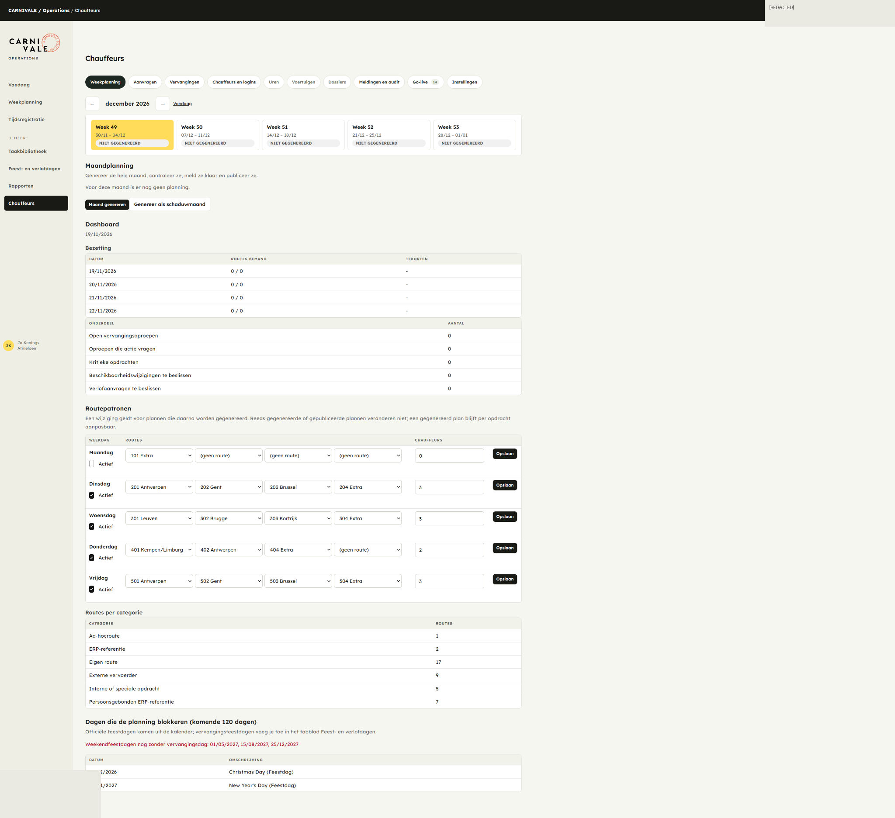

# Driver planning and route patterns

**Audience:** Driver planning administrators.  
**Verification:** Deployed **Chauffeurs > Weekplanning** screenshot (19 November 2026) and backend planning modules. Individual assignment editing and publication screens remain to be captured.

## On this page

- [Select a planning month](#select-a-planning-month)
- [Generate a month or a shadow plan](#generate-a-month-or-a-shadow-plan)
- [Review the coverage dashboard](#review-the-coverage-dashboard)
- [Maintain recurring route patterns](#maintain-recurring-route-patterns)
- [Understand planning blockers](#understand-planning-blockers)
- [Publish only after review](#publish-only-after-review)

## Select a planning month

1. Open **Chauffeurs** and select **Weekplanning**.
2. Use the month navigation arrows or **Vandaag**.
3. Inspect the weekly status cards before generating a plan.
4. Confirm whether a plan already exists.

In the supplied example, the selected December 2026 month has no plan yet. The screenshot should not be mistaken for current staffing availability.

## Generate a month or a shadow plan

The displayed actions are **Maand genereren** and **Genereer als schaduwmaand**.

- **Maand genereren** starts standard month generation.
- **Genereer als schaduwmaand** creates a plan for review that remains invisible to drivers until the admin explicitly converts/publishes it.

Recommended operational sequence: verify driver availability and route patterns, generate a **shadow** month, inspect coverage and conflicts, correct issues, then publish deliberately. This reduces accidental notifications or premature publication.

> **Screenshot: driver month planning and generation controls.** The account label is hidden.
>
> 

## Review the coverage dashboard

The captured **Dashboard** includes:

- **Bezetting**: day-by-day required routes and staffing shortfalls.
- **Open vervangingsoproepen**: open replacement calls.
- **Oproepen die actie vragen**: replacement calls requiring attention.
- **Kritieke opdrachten**: critical assignment items.
- **Beschikbaarheidswijzigingen te beslissen**: availability decisions pending.
- **Verlofaanvragen te beslissen**: leave requests pending.

Review each count before publication. A zero may mean no plan was generated yet, not that staffing is adequate.

## Maintain recurring route patterns

The **Routepatronen** table allows recurring weekday definitions. The screenshot shows:

- **Weekdag**: day of week.
- **Routes**: route dropdowns, with **(geen route)** where unused.
- **Chauffeurs**: number of drivers expected.
- **Actief** checkbox to enable a weekday pattern.
- **Opslaan** to save the row.

Changes apply to **plans generated after the change**. Existing generated or published plans remain unchanged. This is also the explicit rule shown under Routekennis.

Route familiarity is configured in [Driver profiles and route knowledge](drivers-and-logins.md), and affects the planning inputs.

## Understand planning blockers

The lower page shows:

- **Routes per categorie**: route counts grouped by type.
- **Dagen die de planning blokkeren (komende 120 dagen)**: upcoming holidays/closures that block planning.
- A warning for weekend holidays missing a replacement day.

Validate these before the next generation. Taskboard administrators maintain official and manual dates under [Holidays and closures](../taskboard/holidays-and-closures.md).

## Publish only after review

Before publication, check each driver's availability, approved leave, route knowledge, hard constraints, coverage, and replacement risks. Where an override is necessary, follow the backend's documented review/audit process.

The screenshots do not show the final **publish** or **convert shadow plan** controls. These steps are not represented as verified click-by-click UI instructions until their capture.

[Driver App contents](README.md) | [Driver management](drivers-and-logins.md) | [Requests/replacements](requests-and-replacements.md)
