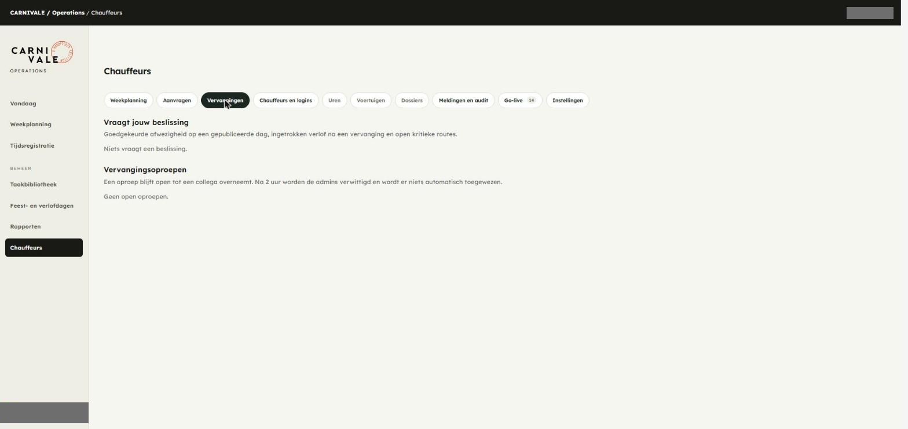
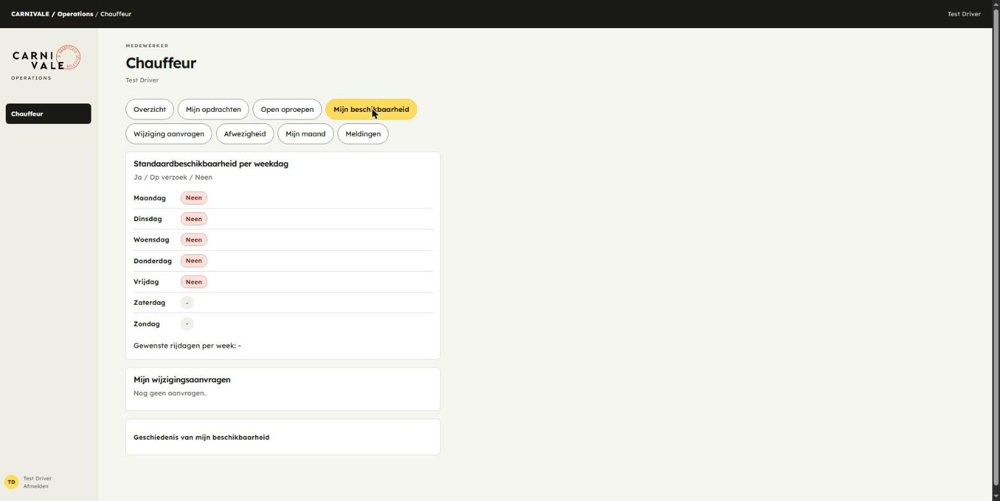

# Driver availability, leave and replacements

**Audience:** Drivers, operations planners and Operational Admin.  
**Verification:** The **Aanvragen** and **Vervangingen** tabs are visible in the screenshots, and the backend implements the rules described here. Their detailed screens were **not** included in the uploaded captures, so exact button labels remain to be verified.

## On this page

- [What goes into Aanvragen](#what-goes-into-aanvragen)
- [Availability and leave decisions](#availability-and-leave-decisions)
- [How replacements are offered](#how-replacements-are-offered)
- [Reminders and escalation](#reminders-and-escalation)
- [Screenshots still required](#screenshots-still-required)

## What goes into Aanvragen

**Open directly:** [Chauffeurs → Aanvragen](https://carnivale.frappe.cloud/taskboard/admin#drivers/requests).

The Driver App supports driver availability change requests and leave requests. The admin reviews the request and decides whether to approve it. A submitted change does **not** automatically override the existing published driver schedule.

Planners should verify the requested date, affected driver, current plan and route staffing before making a decision. Employees should verify that the request status changes to approved rather than assuming the submission was accepted.

## Availability and leave decisions

1. Review pending requests in the authorized admin workflow.
2. Confirm the driver's current availability version and affected dates.
3. Check whether an already published route will need coverage.
4. Approve or reject with an auditable decision.
5. Where approved leave affects a published assignment, review the required replacement action.
6. Confirm the driver has received the correct outcome through the enabled notification channels.

The source describes changes as effective for future planning only after approval, not as retroactive changes to completed work.

## How replacements are offered

**Open directly:** [Chauffeurs → Vervangingen](https://carnivale.frappe.cloud/taskboard/admin#drivers/replacements).

The backend has a replacement-call workflow. Eligible drivers can receive an offer containing the shift's **date, route, start and expected duration**. The receiving driver must not see private details about the colleague requesting replacement.

- Driver accepts or declines an offered replacement.
- The first valid acceptance wins; a late competing acceptance does not create a second assignment.
- Admin monitors open calls and resulting coverage.
- Replacement criteria check availability, scheduling conflicts and other configured constraints.

## Reminders and escalation

The technical specification describes an automatic reminder after approximately one hour and escalation after two hours for unresolved replacement calls, with idempotent processing. These are backend timing defaults that should be checked against the deployed configuration before operational reliance.

## Screenshots still required

> **Admin requests queue:** `driver-app/images/admin-requests.png`, show a fictional pending availability/leave request and the decision controls.
>
> 

> **Admin replacement calls:** `driver-app/images/admin-replacements.png`, show one fictional offer, candidate/response state and final allocation.
>
> 

> **Driver phone request:** `driver-app/images/driver-availability.png`, with its actual form/status once the mobile UI is verified.
>
> 

[Driver App contents](README.md) | [Driver planning](planning-and-routes.md) | [Driver guide](driver-guide.md)
