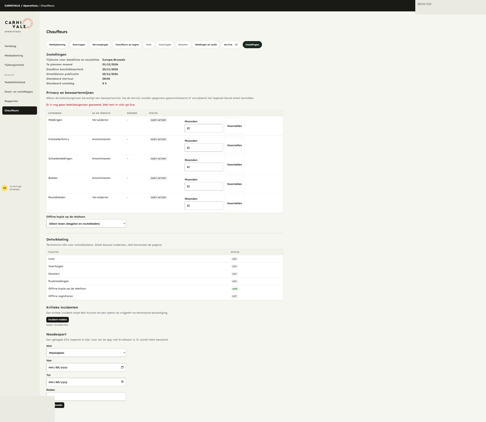
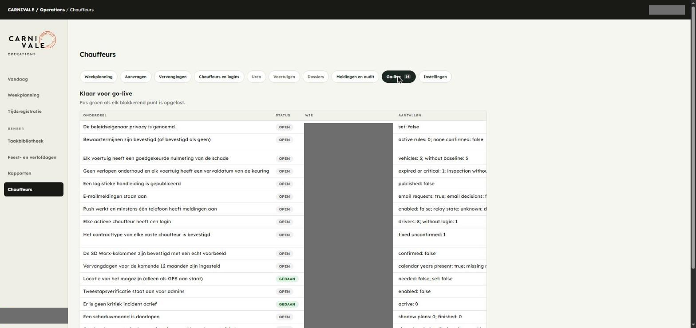

# Driver App settings, safety controls and go-live

**Audience:** Operational Admin, system owner and designated privacy/policy owner.  
**Verification:** The 19 November 2026 **Instellingen** screenshot shows the controls described below. Backend documentation defines how feature switches and safety gates operate. Tab **Go-live** is visible in the screenshot, but its complete contents were not captured.

## On this page

- [Review the general settings](#review-the-general-settings)
- [Review privacy and retention](#review-privacy-and-retention)
- [Understand development switches](#understand-development-switches)
- [Handle critical incidents](#handle-critical-incidents)
- [Use the emergency export](#use-the-emergency-export)
- [Prepare the go-live review](#prepare-the-go-live-review)

## Review the general settings

**Open directly:** [Chauffeurs → Instellingen](https://carnivale.frappe.cloud/taskboard/admin#drivers/settings).

Open **Chauffeurs** > **Instellingen**. The settings screenshot displays operational scheduling parameters such as:

- **Tijdzone voor deadlines en escalaties:** Europe/Brussels in the example.
- The monthly planning deadline and availability deadline.
- The publication target date.
- Standard starting hour and standard workday length.

These are organization-level parameters. The displayed dates and defaults are sample captured values, not a replacement for the current approved operating policy.

## Review privacy and retention

**Open directly:** [Driver privacy settings](https://carnivale.frappe.cloud/taskboard/admin#drivers/settings).

In **Privacy en bewaartermijnen**:

1. Check whether a policy owner has been formally appointed.
2. Check the per-category period and data action.
3. Use **Voorstellen** to propose a retention period when authorized.
4. Ensure the designated policy owner confirms the policy before activation.

The screenshot shows **no policy owner appointed** and retention rules marked not active. Do not infer that the retention cleanup is already operating safely.

## Understand development switches

The **Ontwikkeling** section lists function statuses. The captured example shows:

| Function | Screenshot status |
| --- | --- |
| **Uren** | Uit (off) |
| **Voertuigen** | Uit (off) |
| **Dossiers** | Uit (off) |
| **Pushmeldingen** | Uit (off) |
| **Offline kopie op de telefoon** | Aan (on) |
| **Offline registreren** | Uit (off) |

These are **snapshot states from 19 November 2026**, not a permanent description of the application. The source also documents a master enabled switch, separate workday/vehicle/dossier switches, restricted HR payroll export, and optional push/offline write behavior.

A visible navigation tab does not override the switch status. Rollouts must be approved and tested one function at a time.

> **Screenshot: Driver App settings, policy controls, development switches, incidents and export.** The account label is obscured.
>
> 

## Handle critical incidents

**Open directly:** [Driver settings and incidents](https://carnivale.frappe.cloud/taskboard/admin#drivers/settings) · [Meldingen en audit](https://carnivale.frappe.cloud/taskboard/admin#drivers/audit).

The **Kritieke incidenten** section includes **Incident melden**. Backend behavior is designed to stop the affected function and require deliberate technical confirmation before release.

Do not use an incident switch as a routine pause or as a substitute for proper operations review.

## Use the emergency export

The **Noodexport** section has controls for the export type, **Van**, **Tot**, **Reden** and **Downloaden**. The screenshot description states that the export is logged, period-limited and not stored by the application.

Use it for authorized continuity needs only, and handle exported personal information under the organization's approved privacy policy.

## Prepare the go-live review

**Open directly:** [Chauffeurs → Go-live](https://carnivale.frappe.cloud/taskboard/admin#drivers/golive).

The **Go-live** tab is visible with an unresolved-items count in the screenshot, but the contents have not been captured. Backend readiness checks include:

- Privacy owner and approved retention policies.
- Driver profiles/logins and availability.
- Vehicle baseline and maintenance readiness where enabled.
- Manual versions and acknowledgments.
- Email/push setup and accepted notification behavior.
- Payroll export mapping where used.
- Outstanding critical incidents.
- Shadow planning and acceptance evidence.

The technical specification requires separate acceptance by the project owner, operational owner and developer. Do not treat a green button or an empty dashboard as sole proof of readiness.

> **Screenshot still needed:** `driver-app/images/admin-readiness.png`, after a controlled staging walkthrough with private data hidden.
>
> 

[Driver App contents](README.md) | [Admin navigation](admin-navigation.md)
