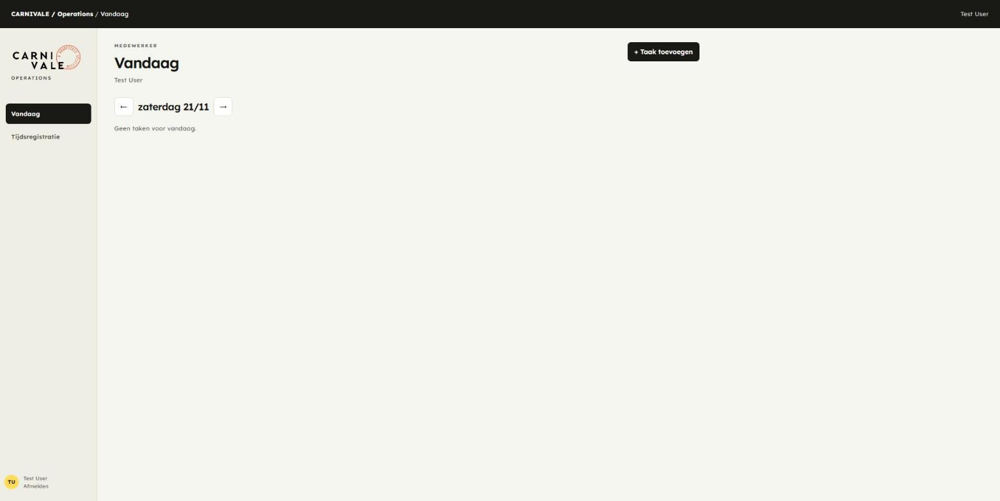

# Taskboard

**Operational Week & Task Board**

This guide covers the Carnivale operational task board used by warehouse, production and other operational teams. Employees work from their daily tasks. Team leaders and administrators configure the task library, schedule work and review execution.

**Documentation status:** Employee and admin pages are verified in the current `carnivale-b2b` frontend, and task logic is verified in `carnivale_operations`. Exact deployment, visual appearance and all user permissions require a final production walkthrough. Interface buttons are currently mainly in Dutch.

## On this page

Select a section to jump directly to it.

- [Open the app](#open-the-app)
- [Which guide do you need?](#which-guide-do-you-need)
- [Roles at a glance](#roles-at-a-glance)
- [Important concepts](#important-concepts)
  - [Typical workflow](#typical-workflow)

## Open the app

- **Employee Taskboard:** [Open `/taskboard`](https://carnivale.frappe.cloud/taskboard)
- **Management and planning:** [Open `/taskboard/admin`](https://carnivale.frappe.cloud/taskboard/admin)

Access requires a valid account, the relevant operational role and a linked Employee record.

## Which guide do you need?

| I want to... | Guide |
| --- | --- |
| See and complete my daily work | [Employee guide](employee-guide.md) |
| Generate, schedule and validate a week | [Detailed weekly planning guide](week-planning.md) |
| Create, edit and manage templates | [Task library guide](task-library.md) |
| Configure holidays and closures | [Holidays and closures](holidays-and-closures.md) |
| Add a personal task or one from the library | [Employee guide](employee-guide.md#add-a-task) |
| Report an unfinished task or move a task | [Employee guide](employee-guide.md#report-a-task-as-not-done) |
| Generate and validate weekly plans | [Administrator guide](admin-guide.md) |
| Manage task templates and holidays | [Administrator guide](admin-guide.md#manage-the-task-library) |
| Scan the attendance QR code | [Attendance guide](attendance.md) |
| View execution metrics and export CSV | [Reports guide](reports.md) |
| Fix common problems | [Troubleshooting](troubleshooting.md) |

## Roles at a glance

- **Operational Employee:** opens the employee board, works on eligible tasks, adds personal tasks and uses attendance.
- **Operational Team Leader:** accesses management screens and can plan/manage tasks, subject to server checks.
- **Operational Admin:** accesses management screens and additional person-level reporting and attendance administration.

The board may display tasks owned by other teams for awareness. **Visible does not always mean editable.** The server enforces permission checks.

## Important concepts

| Term in the app | Meaning |
| --- | --- |
| **Vandaag** | Today, the employee task list |
| **Uitgevoerd** | Completed |
| **Niet uitgevoerd** | Not completed, with a reason |
| **Verplaatsen** | Move an eligible task to another working day |
| **Vaste taak** | Recurring task; may be completion-tracked or informational |
| **Extra** | Added to an existing week by an employee or planner |
| **Taakbibliotheek** | Reusable task templates |
| **Weekplanning** | Management calendar and weekly task plan |
| **Te plannen** | Flexible recurring tasks requiring placement by a planner |
| **Concept / Gevalideerd** | Draft versus validated week |

### Typical workflow

1. Manager sets up active templates and calendar dates.
2. Manager generates a week.
3. Manager assigns, moves or supplements tasks, then validates the plan.
4. Employees open **Vandaag**, complete tasks, or record a reason when something cannot be done.
5. Managers review execution and follow up on open tasks and exceptions.

> **Screenshot to add:** Capture the employee **Vandaag** screen with several fictitious tasks, the date navigation and the completion summary.
> **File to upload:** `taskboard/images/taskboard-overview.png`

See [all screenshot requests](../SCREENSHOTS.md). The uploaded 19 November screenshots have been matched to the guides. Sanitized image files are prepared for repository upload and are not yet present in GitHub.

[Back to documentation home](../README.md)
