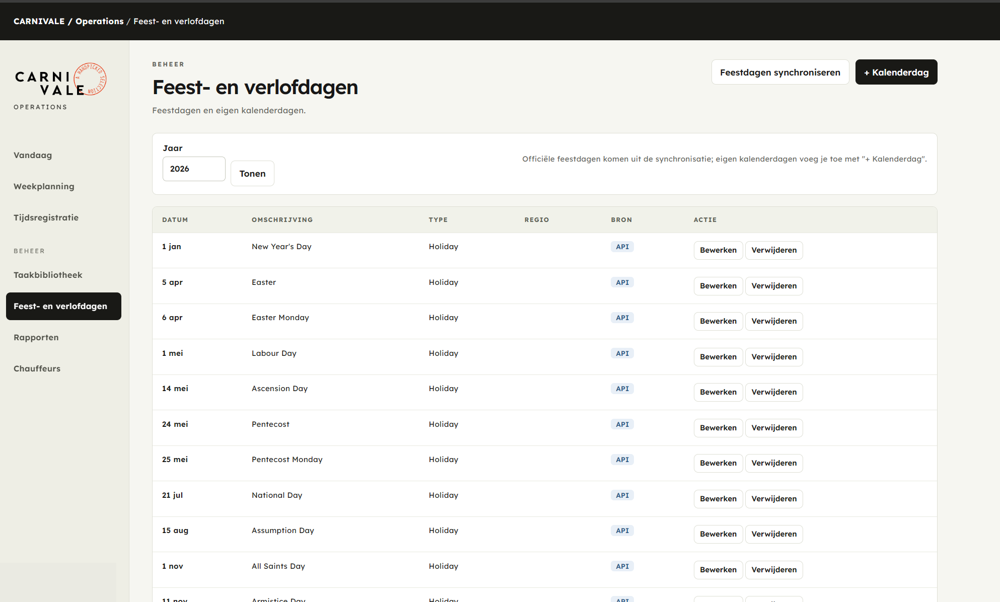
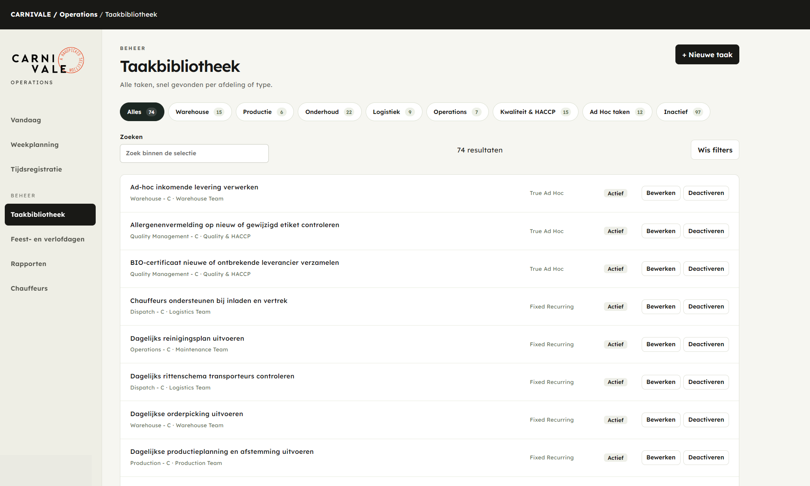
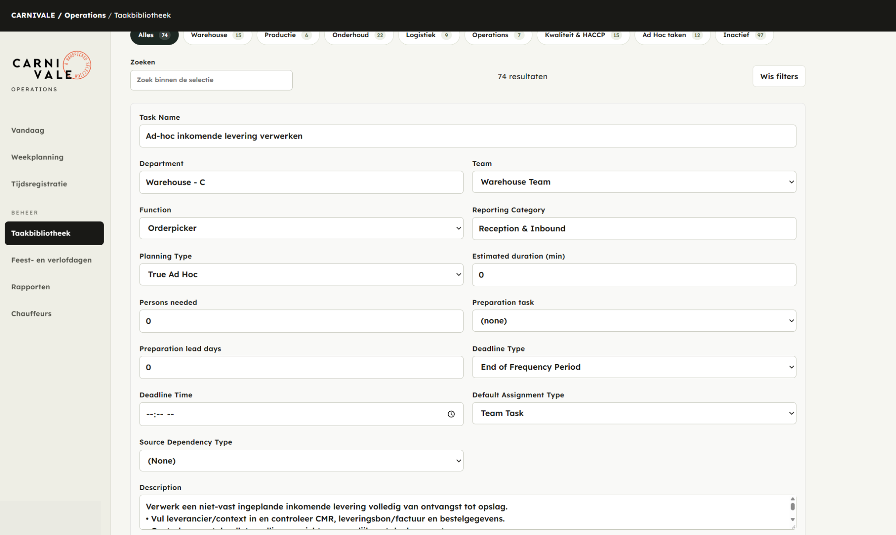
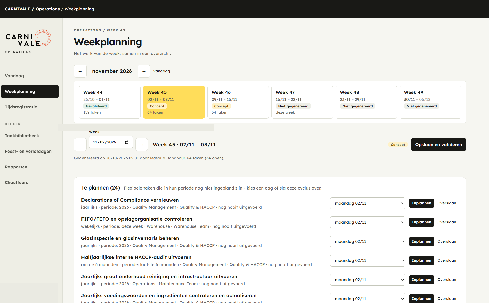
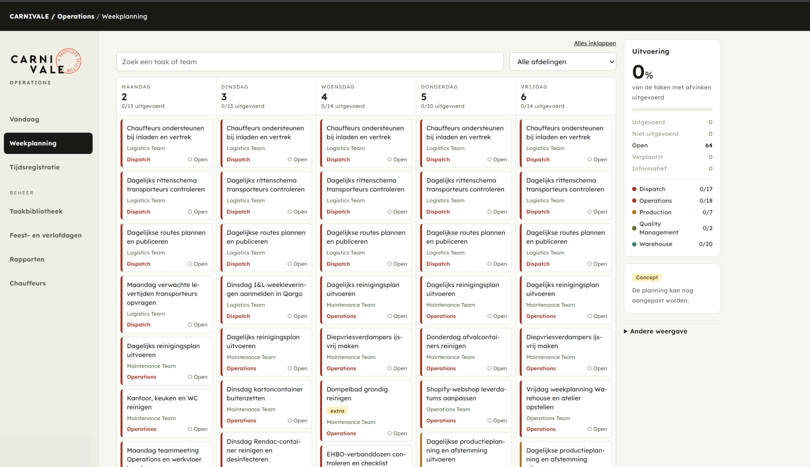

# Taskboard administrator and team leader guide

**Audience:** Operational Admin and Operational Team Leader.  
**Status:** Source-verified workflows; screen captures and live deployment configuration still require confirmation.

Open [`/taskboard/admin`](https://carnivale.frappe.cloud/taskboard/admin). The management application has four principal sections: **Feest- en verlofdagen**, **Taakbibliotheek**, **Weekplanning** and **Rapporten**.

For illustrated step-by-step instructions, use [Weekly planning](week-planning.md), [Task library](task-library.md), and [Holidays and closures](holidays-and-closures.md).

## On this page

Select a section to jump directly to it.

- [1. Prepare the operational calendar](#1-prepare-the-operational-calendar)
- [2. Manage the task library](#2-manage-the-task-library)
  - [Main template fields](#main-template-fields)
  - [Planning types](#planning-types)
- [3. Generate and validate a week](#3-generate-and-validate-a-week)
- [4. Assign, move and correct tasks](#4-assign-move-and-correct-tasks)
- [5. Understand team permissions](#5-understand-team-permissions)
- [6. Monitor execution](#6-monitor-execution)
- [7. Release checklist for a new planning week](#7-release-checklist-for-a-new-planning-week)
- [Screenshot requirements](#screenshot-requirements)

## 1. Prepare the operational calendar

Open **Feest- en verlofdagen** (Holidays and leave days).

1. Select the correct year under **Jaar** and click **Tonen**.
2. Select **Feestdagen synchroniseren** to import official holidays.
3. For an internal closure or replacement day, click **+ Kalenderdag**.
4. Enter **Date**, **Type**, **Region** if applicable and **Description**, then **Save**.
5. Use **Bewerken** or **Verwijderen** to maintain calendar entries.

Official holidays are imported as system-sourced entries. Manually added substitute holidays, bridge days and closures are separate. School holidays marked *Informational* do **not** automatically stop task scheduling; holiday, replacement holiday, bridge day and closure entries are non-working-day types for planning logic.

**Before generating a week, check the calendar.** Calendar mistakes can suppress otherwise expected tasks.

> **Screenshot to add:** Show the year filter, sync action, and a sample manual closure day.
> **File to upload:** `taskboard/images/admin-holidays.png`

## 2. Manage the task library

Open **Taakbibliotheek** (Task Library).

1. Use the team/category chips, search field and inactive filter to find a template.
2. Select **+ Nieuwe taak** to add a template, or **Bewerken** to change one.
3. Enter at least the task name and department, then complete the relevant fields.
4. Select the correct planning type and assignment behavior.
5. Save the template, then inspect it in the library.
6. Deactivate an obsolete template rather than removing it casually.

### Main template fields

| Field | Purpose |
| --- | --- |
| Task Name / Description | What the employee must do |
| Department / Team / Function | Operational ownership |
| Planning Type | How the task reaches the week |
| Estimated duration / Persons needed | Planning estimates |
| Deadline Type / Time | When work is due |
| Default Assignment Type / Default Assignees | Assigned worker(s) or a team task |
| Preparation task / lead days | Optional linked preparation |
| Active | Whether the template participates |
| Completion required | Whether it must be checked off |
| Allow multiple assignees / move / carry-over | Allowed execution behavior |
| Show in 'Te plannen' list | Whether a planner must place it |

### Planning types

- **Fixed Recurring:** normally generated automatically according to its schedule.
- **Flexible Recurring:** appears in **Te plannen** for a manager to place or skip for the relevant cycle.
- **Planned / Linked:** added explicitly, and may have linked preparation work.
- **True Ad Hoc:** can be selected from the employee's library if eligible.

**Important:** The planning type supplies default values, but completion and display flags can be overridden per template. Review them instead of assuming every recurring task needs the same treatment.

The management form links to **Edit recurrence rules in Desk**. Recurrence rules are not fully edited in this web form, so maintain those in the authorized ERPNext Desk when necessary.

> **Screenshot to add:** Capture search, filters, an active template and the edit action.
> **File to upload:** `taskboard/images/admin-library.png`

>
> **Screenshot to add:** Capture the template form, planning type, assignment fields and recurrence link.
> **File to upload:** `taskboard/images/admin-template-editor.png`

## 3. Generate and validate a week

Open **Weekplanning**.

1. Navigate by month cards, previous/next week arrows or the date picker.
2. Check the selected week's status.
3. If it has not been generated, select **Genereren**.
4. Review tasks, dates, assignments, linked work and the **Niet automatisch ingepland** explanation list.
5. Review **Te plannen** (flexible recurring work). Place applicable items or select **Overslaan** when appropriate.
6. Assign an individual worker or leave the task as **Team**, when the template and plan permit.
7. Add an extra task using **Taak toevoegen**. For a linked task, review the optional preparation-task proposal and date.
8. Verify the calendar view and the execution/details panel.
9. Select **Opslaan en valideren** once the draft is correct.

The week transitions from **Concept** (Draft) to **Gevalideerd** (Validated). Changes to planned tasks are restricted after validation. If a correction is necessary, select **Heropenen** and verify the changes before validating again.

**Do not routinely reopen validated weeks**, because employees may already have worked from the published plan.

**Captured example:** A draft week with month navigation, flexible tasks under **Te plannen**, and **Opslaan en valideren**. For an ungenerated week and detailed actions, see the [Weekly Planning Guide](week-planning.md).

>
> **Screenshot to add:** Show the calendar by day, department colors, task cards and detail panel.
> **File to upload:** `taskboard/images/admin-week-calendar.png`

## 4. Assign, move and correct tasks

In a draft week, click a task card to open details.

- Use the assignment selector to assign an active team member when permitted.
- Select **Verplaatsen** to reschedule an open task.
- Select **Verwijderen** to remove an eligible task from the week.
- Select **Ongedaan maken** on a moved task to undo its move, if eligible.
- Check linked preparation tasks separately. Moving one member of a linked pair **does not automatically move the other**.

The management view displays task status, department, team, context and related tasks. Review the schedule after any move.

## 5. Understand team permissions

The employee board is broader than the management page.

| Action | Employee | Team Leader | Operational Admin |
| --- | --- | --- | --- |
| See own daily board | Yes | Yes | Yes |
| Complete eligible own/team task | Yes | Yes | Yes |
| Manage weekly plan | No | Yes | Yes |
| Manage task library and calendar | No | Yes | Yes |
| See department/day/task reports | No | Yes | Yes |
| See person-level report and assignee filter | No | No | Yes |
| Manage attendance location QR | No | Check authorization | Yes |

Actual server role checks remain authoritative. A manager's ability to complete another team's task is subject to the task's status and day.

## 6. Monitor execution

Go to **Rapporten** and select a date range, department, status and, for Operational Admins, employee. Export the filtered results using **Exporteer selectie**.

See [Reporting and CSV exports](reports.md) for the precise counting rules.

## 7. Release checklist for a new planning week

- [ ] Holiday and closure dates are correct.
- [ ] Relevant task templates are active and have the right recurrence.
- [ ] Flexible tasks in **Te plannen** have been placed or intentionally skipped.
- [ ] Assignments reflect available staff.
- [ ] Linked preparation work is on the correct day.
- [ ] The week has been validated.
- [ ] Employee access is confirmed.
- [ ] Managers know how to handle corrections and unfinished tasks.

## Screenshot requirements

See [screenshot checklist](../SCREENSHOTS.md). Use fictional data and mask employee identifiers.

[Taskboard contents](README.md) | [Reports](reports.md) | [Troubleshooting](troubleshooting.md)
