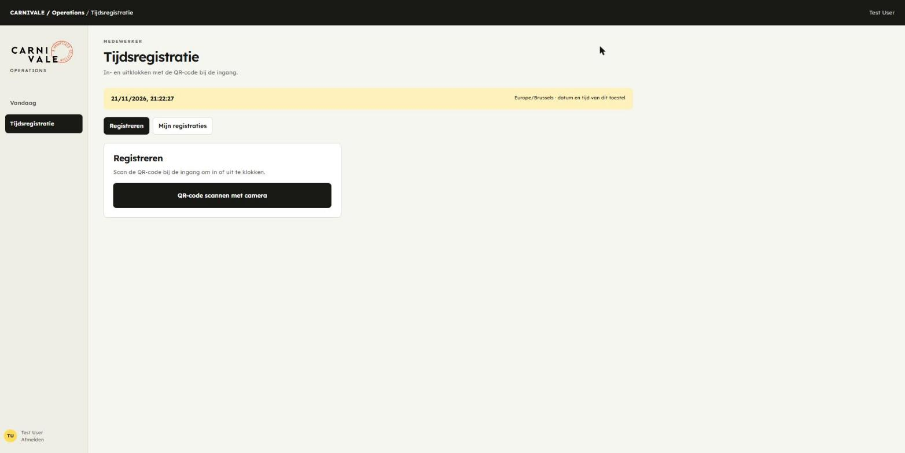
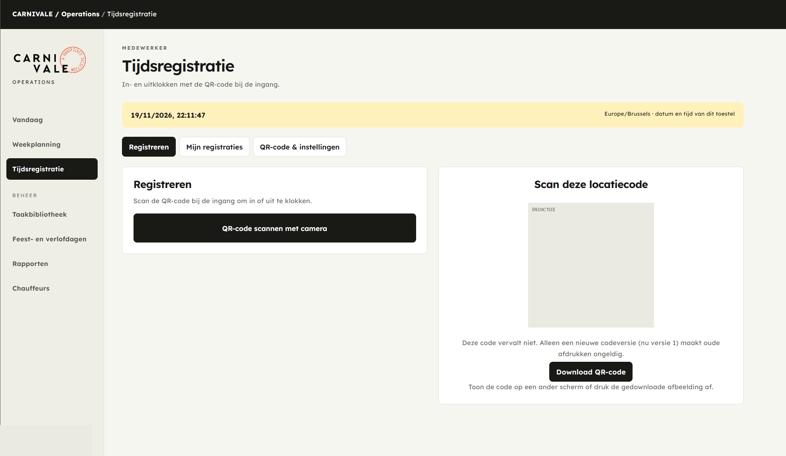
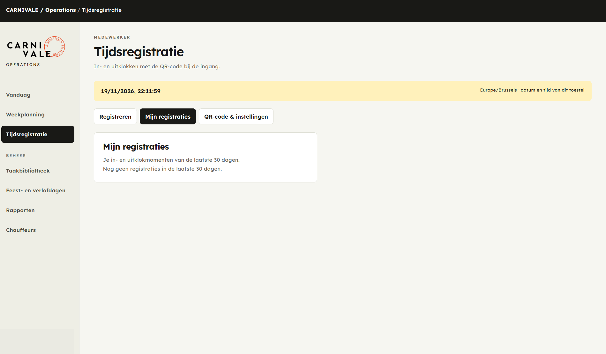

# Attendance and QR check-in

**Audience:** Employees, team leaders and operations administrators.  
**Status:** Verified in employee page and attendance API source; device/browser behavior needs a live test.

## On this page

Select a section to jump directly to it.

- [Employee: clock in or out](#employee-clock-in-or-out)
- [Administrator: display or print the location QR](#administrator-display-or-print-the-location-qr)
- [Common issues](#common-issues)

## Employee: clock in or out

**Open directly:** [Tijdsregistratie, QR check-in and registrations](https://carnivale.frappe.cloud/taskboard#tijdsregistratie). The registration and history tabs are inside this screen.

1. Open [Taskboard](https://carnivale.frappe.cloud/taskboard) and sign in.
2. Open **Tijdsregistratie** (Time Registration).
3. At the workplace entrance, select **QR-code scannen met camera**.
4. Scan the displayed or printed **location QR code**.
5. Wait for the on-screen result. The application records a check-in or check-out through the server after it validates the scanned token.
6. If the camera is unavailable, follow the screen's photo-based QR fallback.
7. Open **Mijn registraties** (My registrations) to review entries from the previous 30 days.

**Important:** A direct visit to Taskboard is not the same as proving that you are at the workplace. The workflow requires the location QR code. Do not share a photograph of the live code or use it from outside the workplace.

> **Screenshot to add:** Capture the **Tijdsregistratie** page with the **Registreren** and **Mijn registraties** tabs.
> **File to upload:** `taskboard/images/attendance-employee.png`

>
> **Screenshot to add:** Capture a successful example check-in result without exposing the QR token.
> **File to upload:** `taskboard/images/attendance-scan-result.png`

## Administrator: display or print the location QR

**Open directly:** [Attendance settings and location QR](https://carnivale.frappe.cloud/taskboard#tijdsregistratie). This panel is permission-controlled; never share the live QR in a public document.

The employee page contains an additional admin-only QR card.

1. Sign in with an authorized **Operational Admin** account.
2. Open **Tijdsregistratie**, then **Registreren**.
3. Look for **Scan deze locatiecode**.
4. When check-in is enabled, select **Download QR-code** and print the image for display at the designated entrance.
5. Confirm that the print is readable by a typical employee phone.

The QR card is not simply hidden with CSS. The server does not render it to unauthorized accounts. If **Operational Attendance Settings** has check-in disabled, the QR code is not available and the page explains why.

The displayed location code remains valid until an authorized administrator rotates the code version, which invalidates earlier printed copies.

> **Screenshot to add:** Show the admin QR download area **with the QR image itself completely obscured**. Never store an active location QR or token in this public wiki.
> **File to upload:** `taskboard/images/attendance-admin-qr-redacted.png`

**Captured example:** The **Mijn registraties** tab displays time entries from the previous 30 days. The example happens to have no entries and therefore does not demonstrate a successful clock-in.

## Common issues

| Symptom | Action |
| --- | --- |
| Camera permission denied | Allow camera access for the site, or use the photo fallback |
| Scanner does not find a QR | Improve lighting and focus; retry with the entrance code |
| The app says the QR is invalid | Confirm you scanned the workplace attendance QR, not another code |
| QR code not shown to admin | Confirm the correct role and enabled attendance setting |
| Old printed QR no longer works | Ask the administrator whether the QR version changed |
| My record is missing | Retry the normal process and tell an admin; do not guess or duplicate an entry |

**Privacy:** Attendance records are personal employee data. Capture example screenshots using test accounts and masked times.

[Taskboard contents](README.md) | [Troubleshooting](troubleshooting.md)
