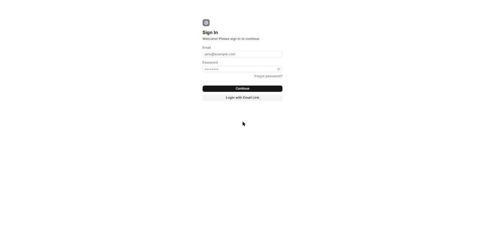
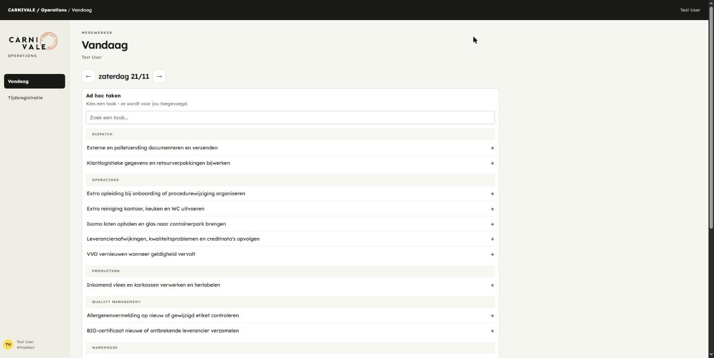

# Taskboard employee guide

**Audience:** Operational employees.  
**Status:** Source-verified guide, pending live screenshot and production acceptance review.

## 1. Sign in

1. Go to [Carnivale Taskboard](https://carnivale.frappe.cloud/taskboard).
2. If prompted, enter your email address and password under **E-mail** and **Wachtwoord**.
3. Select **Aanmelden** (Sign in).
4. Open **Vandaag** (Today). Your employee name is displayed above the list.

Your account must be linked to an Employee record and have access to the operational board. Contact a manager if your credentials work but the page says you are not allowed.

> **Screenshot to add:** Capture the login form with no real credentials entered.
> **File to upload:** `taskboard/images/employee-sign-in.png`

## 2. Understand your daily list

Under **Vandaag**:

- Tasks are grouped by department.
- Your assigned tasks and applicable team tasks can be completed.
- Open tasks from other teams may appear for information, but their checkboxes may be disabled.
- The board shows task descriptions, context notes, linked tasks and labels such as **ad hoc**, **extra** or **team**.
- **Verberg afgerond** hides completed tasks without deleting them.
- The progress indicator shows how many completion-tracked tasks are finished. Informational tasks do not count toward the percentage.

Use the previous and next arrows to view other dates. Select **Vandaag** to return to today. **Other dates are read-only in this view:** checkboxes and deletion are only available for today's eligible tasks.

> **Screenshot to add:** Capture an example showing department groups, eligible and read-only tasks, status labels, progress and date controls.
> **File to upload:** `taskboard/images/employee-today.png`

## 3. Mark a task as completed

1. Find the task on the **Vandaag** list.
2. Verify its title and description.
3. Tick its checkbox.
4. The task becomes **Uitgevoerd** (Done) when the server accepts the action.

If you ticked the wrong task, untick the checkbox while the action is permitted to return it to **Open**.

**Note:** A task shown only for information cannot be ticked. A task that has been moved cannot be completed at its original date.

## 4. Report a task as not done

1. On an eligible open task, select **Niet uitgevoerd**.
2. Select a reason in **Reden**.
3. Enter an explanation under **Toelichting**, if useful. An explanation is required when you choose **Other**.
4. Select **Opslaan**.

The task is recorded as **Not Done** and the reason remains visible. If you made a mistake, select **Ongedaan maken** when permitted, then update the task correctly.

Common reason categories include insufficient time, missing material, delivery delay, technical issue and other.

> **Screenshot to add:** Capture the reason selector and note field with a harmless example.
> **File to upload:** `taskboard/images/employee-not-done.png`

## 5. Move a task to another day

1. On an eligible open task, select **Verplaatsen** (Move).
2. Choose **Nieuwe dag** (New day).
3. Pick a valid working day, from tomorrow through the maximum date shown on screen.
4. Confirm **Verplaatsen**.

The original task is marked as moved and linked to its new date. Only eligible completion-tracked tasks may be moved. **An employee cannot undo this move themselves.** Contact a manager if you selected the wrong date.

> **Screenshot to add:** Show the move date picker, maximum allowed date and confirmation button.
> **File to upload:** `taskboard/images/employee-move.png`

## 6. Add a task

Select **+ Taak toevoegen** at the top of **Vandaag**. There are two options.

### Option A: Choose from the task library

1. Search the **Ad hoc taken** (Ad hoc tasks) library.
2. Select an available template.
3. Select a valid **Dag** (Day).
4. Optionally enter a **Notitie** (Note).
5. Select **Toevoegen** (Add).

The selected task is added **for you**, not another employee. Template-based library tasks require a generated week for the selected date. If the week has not been generated, choose another available date or ask the team leader.

### Option B: Create your own task

1. In **Eigen taak**, enter the task title in **Taak**.
2. Optionally enter **Omschrijving**.
3. Choose an allowed **Afdeling**.
4. Select a date and select **Toevoegen**.

A free-text personal task can be dated today, in the past or in the future. A past open task can appear as carried over; a future one appears in the applicable day's view.

You can delete your own eligible open tasks while the deletion action is available. Generated tasks and tasks owned by someone else are not freely deletable by employees.

> **Screenshot to add:** Capture both the task library search and own-task form, without real supplier information.
> **File to upload:** `taskboard/images/employee-add-task.png`

## 7. Read task details correctly

- **Gekoppeld aan** identifies a related task, for example preparation work linked to production.
- **Context** provides planner information such as a production date or quantity.
- **Team** identifies ownership of an unassigned team task.
- **Gepland** indicates the original planned date when a task has moved.
- A task with an information icon may be informational and not require ticking off.

Do not interpret a task's presence as permission to change it. Disabled controls are intentional.

## 8. Attendance

Select **Tijdsregistratie** (Time registration) to scan the entrance QR and view your own check-in history. See [Attendance and QR check-in](attendance.md).

## Quick troubleshooting

| Problem | What to do |
| --- | --- |
| I cannot tick a task | Check that it is today, completion-tracked and assigned to you or your team |
| I cannot choose my move date | The date must be a permitted future working day |
| A library task cannot be added | Ask whether the target week has been generated |
| I moved a task by mistake | Ask a team leader or administrator to correct the plan |
| I cannot access the page | Ask the administrator to check your role and linked Employee |

See [full troubleshooting guide](troubleshooting.md).

[Taskboard contents](README.md) | [Attendance](attendance.md)
