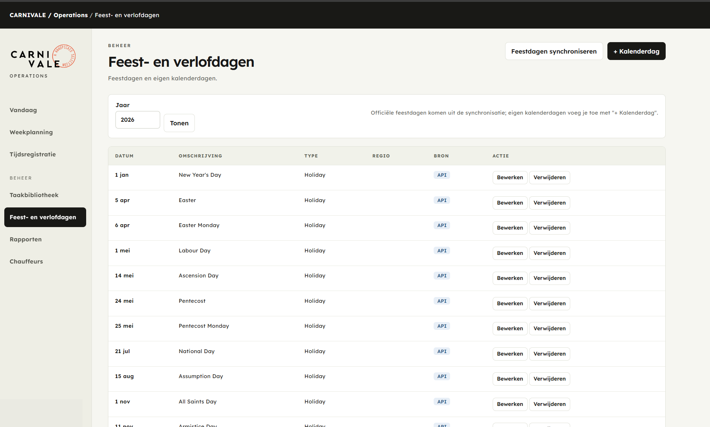
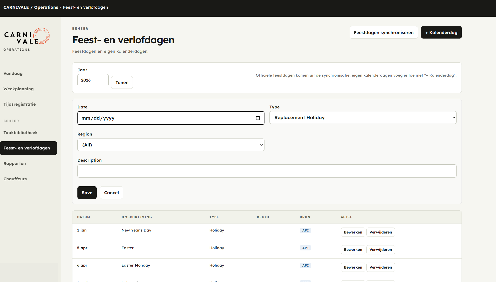

# Holidays, closures and working days

**Audience:** Taskboard planners and administrators.  
**Verification:** Screenshots supplied on 19 November 2026 and the source module for the operational calendar.

## On this page

- [Review the holiday calendar](#review-the-holiday-calendar)
- [Sync official holidays](#sync-official-holidays)
- [Add a manual calendar day](#add-a-manual-calendar-day)
- [Understand scheduling impact](#understand-scheduling-impact)

## Review the holiday calendar

1. Open **Feest- en verlofdagen**.
2. Choose **Jaar** (Year) and select **Tonen**.
3. Review **Datum**, **Omschrijving**, **Type**, **Regio**, **Bron** and **Actie** in the calendar list.
4. Use **Bewerken** or **Verwijderen** only after confirming the entry's origin.

An **API** source marker denotes a synchronized official holiday. A manual calendar entry is maintained separately.

> **Screenshot: official and manual holiday list.**
>
> 

## Sync official holidays

Select **Feestdagen synchroniseren** to fetch public holiday entries for the selected year. This affects API-origin entries; it does not overwrite or remove independently created manual closures simply because the official list changes.

Check the correct year and review the resulting list before scheduling future weeks.

## Add a manual calendar day

1. Select **+ Kalenderdag**.
2. Enter the **Date** and **Type**.
3. Select a **Region** if applicable.
4. Add a clear **Description** and select **Save**.
5. Check the date in the list.

> **Screenshot: calendar-day form.** Includes date, type, region, description and Save/Cancel.
>
> 

## Understand scheduling impact

The following entry types suppress normal workday scheduling:

- Holiday
- Replacement Holiday
- Bridge Day
- Closure

**School Holiday - Informational** is shown for awareness and does not automatically suppress scheduled tasks.

For a date with missing tasks, review both the holiday calendar and the related task template's recurrence rules. Correct the calendar first, then inspect generated weeks and exceptions. Do not assume changes to an already validated week are automatically applied.

[Taskboard contents](README.md) | [Weekly planning guide](week-planning.md)
