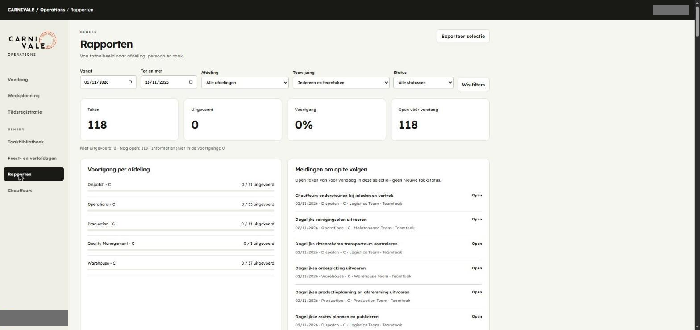
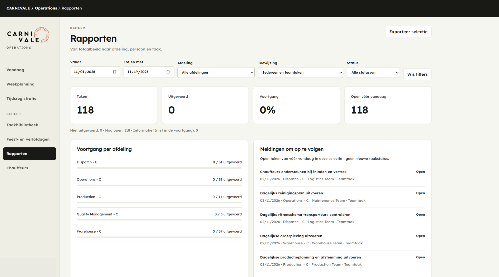

# Taskboard reports and CSV exports

**Audience:** Operational Team Leader and Operational Admin.  
**Status:** Report screen and backend are verified in source. Requires deployment-specific confirmation.

## On this page

Select a section to jump directly to it.

- [Open the reports](#open-the-reports)
- [Understanding the numbers](#understanding-the-numbers)
- [Who can see what?](#who-can-see-what)
- [What to investigate](#what-to-investigate)
- [If reports are missing](#if-reports-are-missing)

## Open the reports

1. Go to [Taskboard Admin](https://carnivale.frappe.cloud/taskboard/admin).
2. Open **Rapporten** (Reports).
3. Select **Vanaf** (From) and **Tot en met** (Through).
4. Optionally filter by **Afdeling** (Department) and **Status**.
5. If you are an Operational Admin, you can also filter by **Toewijzing** (Assignee), including team tasks.
6. Review the totals, department/day breakdown, overdue open tasks and task details.
7. Select **Exporteer selectie** to download the selected report as CSV.

The backend accepts date ranges of **up to 92 days**, inclusive. For a longer analysis, export separate periods.

> **Screenshot to add:** Capture date range, department, status and export action.
> **File to upload:** `taskboard/images/admin-report-filters.png`

>
**Captured example:** Report totals, department progress and open tasks. These values are from the screenshot's selected historical period, **not live current performance**.

## Understanding the numbers

| Status | Report treatment |
| --- | --- |
| **Open** | Included as not completed |
| **Uitgevoerd / Done** | Counts as completed |
| **Niet uitgevoerd / Not Done** | Counts as not completed; a reason may be shown |
| **Verplaatst / Moved** | Original task excluded; its destination copy counts on the new date |
| **Overgeslagen / Skipped** | Excluded |
| **Informational task** | Listed separately, not counted in the completion percentage |

Completion percentage is calculated as:

`Done completion-tracked tasks / all completion-tracked tasks in the selection × 100`

Future open tasks are included when their dates fall within the selected range. This means a report spanning future days may show a lower percentage than a report ending today. An empty selection has no percentage, rather than misleadingly showing 0%.

**Assignment is not proof of who completed a task.** For example, a task assigned to two people can be counted under both people in the person breakdown. The underlying task is still one task.

## Who can see what?

- **Operational Team Leader:** aggregate progress by department/day and task lists.
- **Operational Admin:** the same information plus person-level progress and employee assignment filtering.

The CSV download includes all matching task rows, even if the interactive task list is capped at 500 displayed rows. The CSV uses spreadsheet-friendly UTF-8 encoding.

## What to investigate

- Open tasks dated before today.
- High counts of **Niet uitgevoerd**, grouped by reason.
- Repeat failures in the same department.
- Apparent progress changes caused by date selection or future tasks.

Do not use the percentage alone to judge employee performance. It may reflect workload, scheduling, team assignments or unavailable materials.

## If reports are missing

The admin UI displays a message if the backend reporting module is absent on the current server. Ask the technical administrator to verify that compatible releases of both frontend and operations app are installed; do not assume the report contains zero tasks.

[Taskboard contents](README.md) | [Administrator guide](admin-guide.md)
