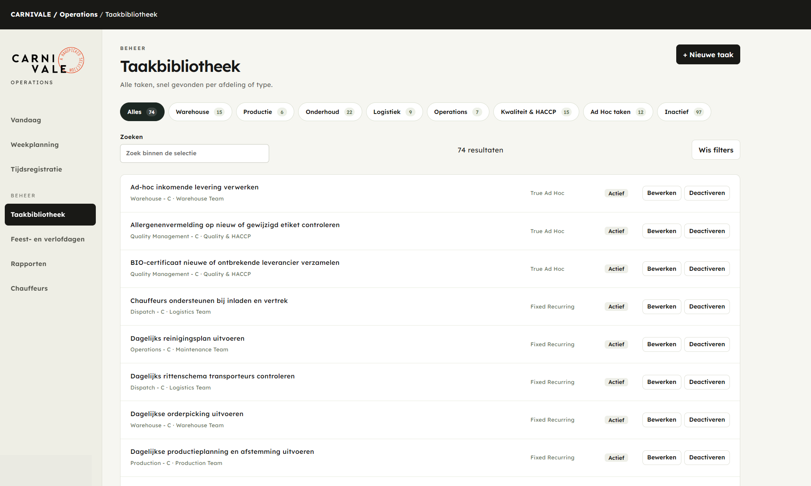
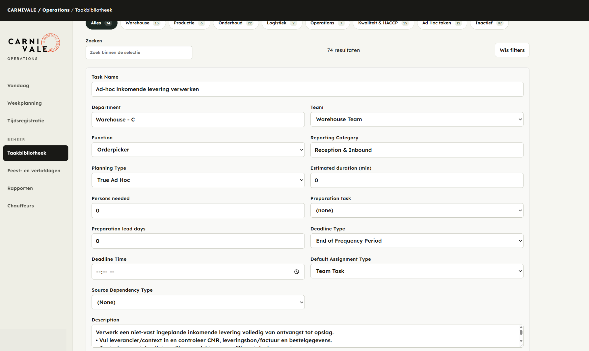
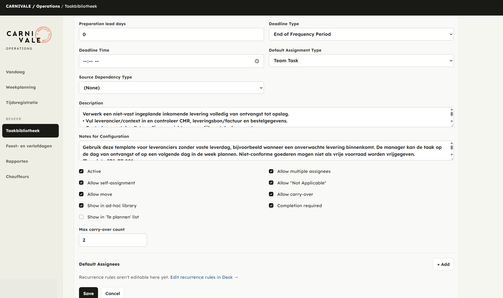

# Task library: finding and maintaining task templates

**Audience:** Operational Admin and Operational Team Leader.  
**Verification:** Source-verified and illustrated by 19 November 2026 screenshots. Screenshots show real settings at capture time, not recommended defaults.

## On this page

- [Find a task template](#find-a-task-template)
- [Create or edit a template](#create-or-edit-a-template)
- [Understand planning types](#understand-planning-types)
- [Advanced fields and checkboxes](#advanced-fields-and-checkboxes)
- [Manage recurrence and deactivate old templates](#manage-recurrence-and-deactivate-old-templates)

## Find a task template

1. Open **Taakbibliotheek** on the administration page.
2. Select a filter chip such as **Warehouse**, **Productie**, **Onderhoud**, **Logistiek**, **Operations**, **Kwaliteit & HACCP**, **Ad Hoc taken** or **Inactief**.
3. Enter a phrase in **Zoek binnen de selectie** (Search within selection).
4. Review the task, department/team, planning type and active state.
5. Select **Bewerken** to edit, **Deactiveren** to deactivate, or **+ Nieuwe taak** to create a template.

The number inside a filter chip is the number of matching templates **in that snapshot**, not a permanently fixed task count. The screenshots show active and inactive templates separately.

> **Screenshot: task-library filters and template list.**
>
> 

## Create or edit a template

In the editor, check the following:

| Field | What it controls |
| --- | --- |
| **Task Name** | The name employees see |
| **Department / Team / Function** | Ownership and who can be assigned |
| **Reporting Category** | Reporting grouping |
| **Planning Type** | How the task enters a week |
| **Estimated duration (min)** | Expected time, if known |
| **Persons needed** | Staffing requirement |
| **Preparation task / lead days** | Optional linked preparation work |
| **Deadline Type / Deadline Time** | Due-date behavior |
| **Default Assignment Type** | Team task or assigned task |
| **Source Dependency Type** | Supplier, route, production, reception or other dependency |
| **Description** | Employee-facing execution instructions |
| **Notes for Configuration** | Internal configuration guidance |

Save with **Save**. Do not change operational rules purely to make a form look complete.

> **Screenshot: upper template editor.** Shows the planning-type, ownership and deadline fields.
>
> 

## Understand planning types

- **Fixed Recurring:** Scheduled automatically according to frequency rules. May require confirmation depending on template settings.
- **Flexible Recurring:** Added to **Te plannen** so a planner can schedule or skip that cycle.
- **Planned / Linked:** Added manually to the week, optionally with a preparation link.
- **True Ad Hoc:** Offered through the ad hoc workflow when eligible.

Always verify **Completion required**, **Show in 'Te plannen' list**, and recurrence rules together. Planning type does not replace all configuration decisions.

## Advanced fields and checkboxes

The lower part of the editor includes **Active**, **Allow multiple assignees**, **Allow self-assignment**, **Allow "Not Applicable"**, **Allow move**, **Allow carry-over**, **Show in ad-hoc library**, **Completion required**, **Show in 'Te plannen' list**, **Max carry-over count**, and **Default Assignees**.

The image illustrates where these controls are located. **Checked items reflect the example template**, not universal settings.

> **Screenshot: advanced template settings and Save button.**
>
> 

## Manage recurrence and deactivate old templates

The web editor states that recurrence rules are **not editable here yet** and links to **Edit recurrence rules in Desk**. Use the authorized ERPNext Desk to modify recurrence safely.

Deactivate a task template that should stop generating new work rather than deleting historical execution records. Before deactivation, confirm whether existing future plans need review.

[Taskboard contents](README.md) | [Weekly planning guide](week-planning.md)
