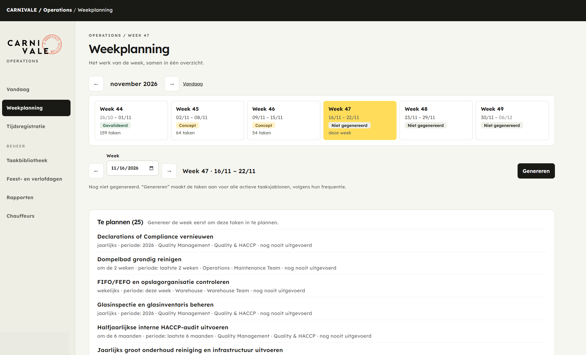
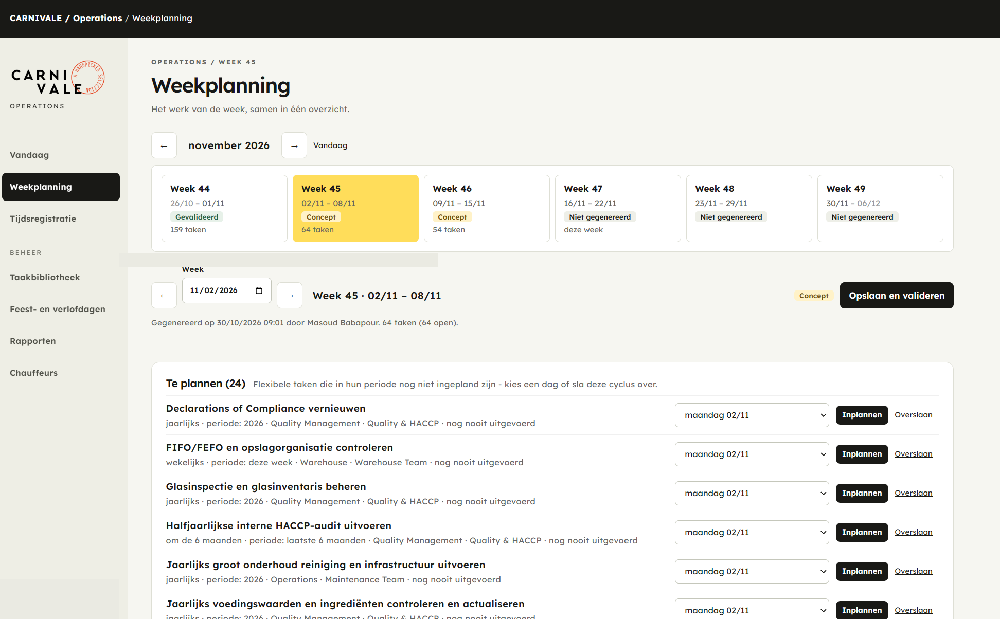
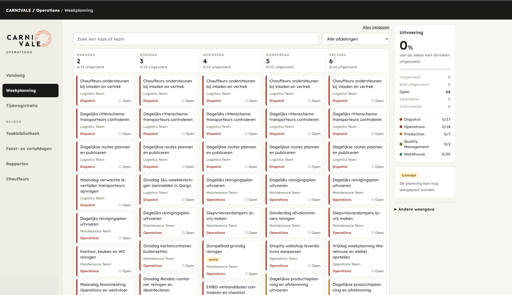
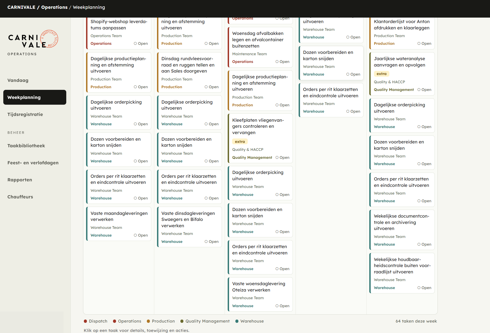

# Weekly planning: from generation to validation

**Audience:** Operational Admin and Operational Team Leader.  
**Verification:** Steps and UI states are supported by the screenshots supplied on 19 November 2026, cross-checked against the Taskboard code. The week numbers and task counts shown in the screenshots are examples, not current instructions.

## On this page

- [Open and choose a week](#open-and-choose-a-week)
- [Understand the week statuses](#understand-the-week-statuses)
- [Generate an unplanned week](#generate-an-unplanned-week)
- [Handle flexible tasks in Te plannen](#handle-flexible-tasks-in-te-plannen)
- [Read the weekly task calendar](#read-the-weekly-task-calendar)
- [Assign, add, move or undo tasks](#assign-add-move-or-undo-tasks)
- [Validate and reopen a week](#validate-and-reopen-a-week)
- [Checklist before publishing](#checklist-before-publishing)

## Open and choose a week

**Open directly:** [Weekplanning in the operations admin](https://carnivale.frappe.cloud/taskboard/admin#weekplanning). The selected week is retained in the URL when you choose one; do not bookmark an unrelated historical week.

1. Sign in to the [Taskboard administration page](https://carnivale.frappe.cloud/taskboard/admin).
2. Select **Weekplanning** in the left navigation.
3. Use the month arrows and **Vandaag** to select a month; the week cards show each week's dates, status and task count.
4. Select a week card or use the date picker and previous/next arrows under **Week**.
5. Confirm the bold week range before editing anything.

The selected week is highlighted in yellow. The date shown in the date input may follow the browser's regional format, while the week range is displayed in day/month format.

## Understand the week statuses

| Status visible on card | Meaning | Available main action |
| --- | --- | --- |
| **Niet gegenereerd** | No week plan exists yet | **Genereren** |
| **Concept** | Generated draft that can be edited | **Opslaan en valideren** |
| **Gevalideerd** | The week has been approved | **Heropenen** to make controlled changes |

The screenshots show different statuses in the same month. A future week should **not** be assumed ready merely because it appears in the month row.

> **Screenshot: ungenerated week.** The selected week is yellow, labeled **Niet gegenereerd**, with **Genereren** on the right. 
>
> 

## Generate an unplanned week

1. Select a week labeled **Niet gegenereerd**.
2. Review the text explaining that **Genereren** will create tasks from active templates according to their frequencies.
3. Select **Genereren**.
4. Verify that the week becomes **Concept** and shows a task count.
5. Review the generated tasks and inspect **Niet automatisch ingepland**, if shown.

**Important:** A non-generated week can already show a **Te plannen** list, but it cannot offer dates for scheduling into that week until generation.

## Handle flexible tasks in Te plannen

**Te plannen** lists flexible recurring tasks due in their period but not yet placed on a date. In the screenshot, a draft week shows the following controls for each item:

- The task name and frequency/period information.
- The relevant department and team.
- A workday selector, for example **maandag 02/11**.
- **Inplannen** to place the task on the selected date.
- **Overslaan** to skip the current cycle when appropriate.

1. For each due item, check whether the work is still required in the current cycle.
2. If required, choose a workday and select **Inplannen**.
3. If it should not be done this cycle, select **Overslaan** and ensure that decision is intentional.
4. Review the remaining **Te plannen** count before validation.
5. If a task was skipped by mistake, check the available **Terugzetten** action.

Do not equate the **Te plannen** count with missed employee work. It is a planning queue, not a report of failed execution.

> **Screenshot: generated draft with flexible tasks.** This example shows the workday dropdown, **Inplannen**, **Overslaan**, and **Opslaan en valideren**.
>
> 

## Read the weekly task calendar

**Open directly:** [Weekly calendar and execution summary](https://carnivale.frappe.cloud/taskboard/admin#weekplanning).

The main week view shows one column per working day. Each task card includes a title, team, department color and status such as **Open**. The right-hand **Uitvoering** panel summarizes task execution and department totals.

Use **Zoek een taak of team** to search and **Alle afdelingen** to narrow visible cards. These filters change the view, not the underlying plan or execution percentage. Select a card to display details, assignment and permitted actions. The alternative **Daglijst** is available through **Andere weergave**.

In the supplied screenshot, the calendar shows 64 tasks, all open, with a 0% progress indicator. This is a historical screenshot state and must not be presented as the business's current performance.

> **Screenshot: weekly calendar and execution dashboard.**
>
> 

> **Screenshot: lower section of the weekly calendar.** It includes further departmental tasks and the color legend.
>
> 

## Assign, add, move or undo tasks

While a week remains **Concept**, a manager can:

1. Open a task's detail panel to inspect team, department, planned day, context and linked task.
2. Select an assignee from the available team member list when that task permits individual assignment, or keep it as a **Team** task.
3. Add an extra task with **Taak toevoegen**, select the date and optional context.
4. Review an optional **preparation task** proposal, including its lead day/date, if present.
5. Use **Verplaatsen** for an eligible open task.
6. Use **Ongedaan maken** for an eligible moved task, or **Verwijderen** for an eligible draft task.

**Linked work does not automatically move together.** When a preparation task changes date, check its linked production task separately and correct any scheduling conflict.

If the week is validated, editing controls are restricted. The interface tells the manager to reopen it before altering tasks.

## Validate and reopen a week

1. Ensure recurring work and flexible **Te plannen** entries have been handled.
2. Check individual assignments, date conflicts and preparation links.
3. Select **Opslaan en valideren**.
4. Confirm the warning. The week becomes **Gevalideerd**.
5. If later corrections are necessary, select **Heropenen**, make and review the changes, then validate again.

Treat reopening as a controlled management action, especially when employees have already started using the plan.

## Checklist before publishing

- [ ] Correct week and month selected.
- [ ] Calendar holidays and closure days reviewed.
- [ ] Recurring work generated as expected.
- [ ] **Te plannen** reviewed and handled.
- [ ] Team and employee assignments checked.
- [ ] Linked preparation tasks checked separately.
- [ ] Exceptional or deleted tasks checked.
- [ ] Draft validated only after a full review.

[Taskboard contents](README.md) | [Admin guide](admin-guide.md) | [Reports](reports.md)
